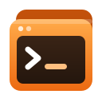
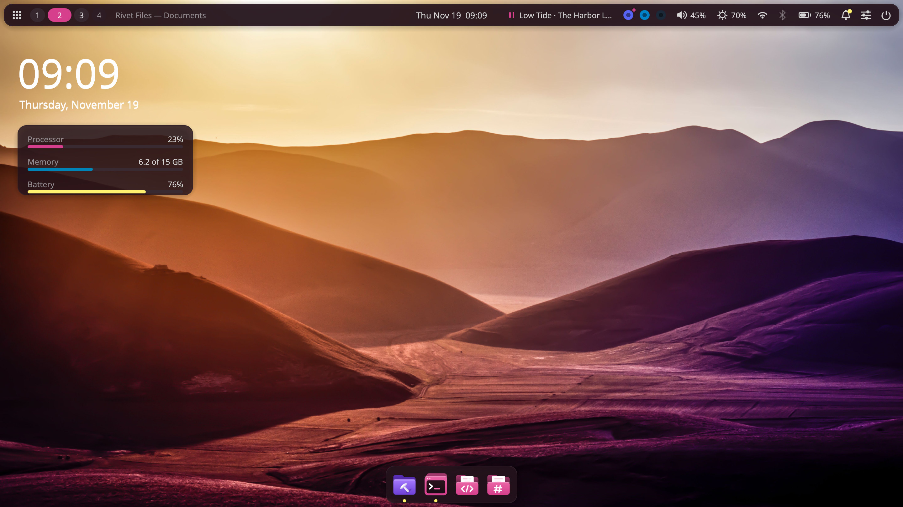
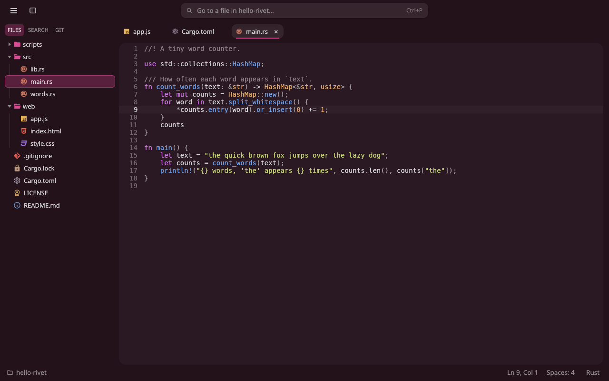
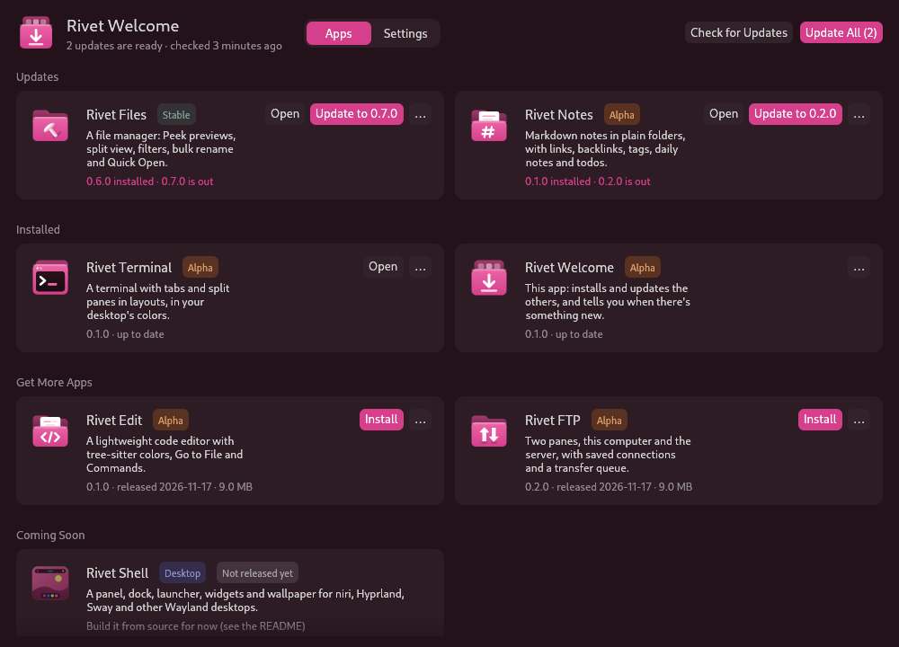

<p>
  
  &nbsp;
  
  &nbsp;
  
  &nbsp;
  
  &nbsp;
  
  &nbsp;
  
  &nbsp;
  
</p>

# Rivet Apps

[](https://github.com/ulinaaron/rivet-apps/actions/workflows/ci.yml)
[](https://github.com/ulinaaron/rivet-apps/releases/latest)
[](#license)
[](#the-apps)
[](https://github.com/emilk/egui)


An ecosystem of Linux desktop software written in Rust, with no GTK or Qt: a desktop shell, a
set of apps, and a small helper that keeps them all up to date.

Every piece works on its own. Rivet Files is a file manager on GNOME, KDE or any other desktop;
Rivet Shell runs alongside whatever apps you already use; nothing needs anything else installed.
Each one is released separately, with its own version and changelog. Put them together, though,
and they behave like one system.

## How they fit together

- **One look.** Every app takes your desktop's colors, fonts and icon theme, light or dark, and
  shares the same menus, toolbars, Preferences and quick panel (Ctrl+P).
- **One set of colors, from your wallpaper.** Rivet Shell runs matugen on the wallpaper you
  pick, and every Rivet app follows those colors live, with no restart.
- **One file picker.** Rivet Files can be the Open and Save window for every app, so your
  sidebar, bookmarks and views are the same everywhere.
- **Shared pieces.** Rivet Terminal uses Rivet Edit's color themes; Rivet Edit colors code the
  way Rivet Files' Peek does; Rivet FTP's saved connections also work from plain `ssh`.
- **A dock that knows them.** Rivet Shell's dock starts out with Files, Terminal, Edit and
  Notes pinned.
- **Kept current in one place.** Rivet Welcome installs and updates every app, and its tray
  icon sits in Rivet Shell's panel (or any other tray).

## Rivet Shell: the desktop

###  Rivet Shell

A desktop shell for Wayland compositors with the layer-shell protocol (niri, Hyprland, Sway and
others): a panel, a dock, an app launcher, quick settings, notifications, desktop widgets and the
wallpaper, which it gives to matugen so every app's colors follow it. Settings in the Rivet look.
**Just started:** not released yet; build it from source.
[More about Rivet Shell](apps/rivet-shell/README.md)



## The apps

###  Rivet Files

A file manager in the same vein as Dolphin, Nemo, Thunar and Caja. Minimal or packed with
panels, your choice: Peek previews, split view, filters, bulk rename, Quick Open, and it can be
your other apps' file picker.
**Stable:** released, with AppImage, archive, Flatpak and AUR packaging.
[More about Rivet Files](apps/rivet-files/README.md)


###  Rivet FTP

A dual-pane file-transfer client: this computer on one side, the server on the other, and a
transfer queue. Saved connections in groups, tabs, editing server files in place, SSH keys, and
saved connections that also work from the command line and plain `ssh`.
**Early alpha, first release 0.1.0:** SFTP works; FTP and FTPS aren't built yet.
[More about Rivet FTP](apps/rivet-ftp/README.md)


###  Rivet Notes

Markdown notes in plain folders. Live editing, properties from the frontmatter, links between
notes with backlinks, folders and tags, a slash menu, and modules for daily notes and super
todos with a list or board.
**Early alpha, first release 0.1.0:** usable, but young.
[More about Rivet Notes](apps/rivet-notes/README.md)


###  Rivet Edit

A lightweight code editor: open a folder or single files, tree-sitter colors for a dozen
languages, Go to File (Ctrl+P) and Commands (Shift+Ctrl+P) on the same quick panel as the other
apps.
**Just started:** not released yet; build it from source.
[More about Rivet Edit](apps/rivet-edit/README.md)



###  Rivet Terminal

A terminal with tabs and split panes in layouts (Tall, Fat, Grid, Side by Side, Stacked), in
your desktop's colors or any of Rivet Edit's color themes. Its keys use Ctrl+Shift, so plain
Ctrl+letters reach your programs.
**Just started:** not released yet; build it from source.
[More about Rivet Terminal](apps/rivet-terminal/README.md)


> **About the alphas.** Rivet FTP and Rivet Notes are young: things may still change or break.
> Their releases are marked as pre-releases. Use them on servers and notes you have backups of.

## Rivet Welcome: keeping it all current

###  Rivet Welcome

Optional: installs and updates the shell and the apps from their releases, and has a tray icon
that looks for new versions when you sign in and tells you when there are some. Apps installed
some other way (AUR, a distribution package) are shown but left alone.
**Just started:** not released yet; build it from source.
[More about Rivet Welcome](apps/rivet-welcome/README.md)



## Install

The shell and every app have their own releases on the [Releases page](https://github.com/ulinaaron/rivet-apps/releases),
told apart by name and tag:

| App | Tags | Downloads |
| --- | --- | --- |
| Rivet Shell | `rivet-shell-v…` | Not released yet: build from source |
| Rivet Files | `v0.6.0` | AppImage, archive, Flatpak bundle; AUR packages. See the [Rivet Files README](apps/rivet-files/README.md#-install) for the libraries the window needs. |
| Rivet FTP | `rivet-ftp-v0.1.0` | An archive (pre-release) |
| Rivet Notes | `rivet-notes-v0.1.0` | An archive (pre-release) |
| Rivet Edit | `rivet-edit-v…` | Not released yet: build from source |
| Rivet Terminal | `rivet-terminal-v…` | Not released yet: build from source |
| Rivet Welcome | `rivet-welcome-v…` | Not released yet: build from source |

For Rivet FTP or Rivet Notes, unpack the archive and run its installer, which puts the program in
`~/.local/bin` and adds it to your app launcher:

```sh
tar xzf rivet-notes-0.1.0-x86_64-linux.tar.gz
cd rivet-notes-0.1.0-x86_64-linux
./install.sh
```

Or let [Rivet Welcome](#rivet-welcome-keeping-it-all-current) install and update them for you,
or build any of them from source (below).

## Build from source

You need Rust 1.88 or newer. From the top of the repository:

```sh
cargo build --release -p rivet-shell     # Rivet Shell
cargo build --release                    # Rivet Files (the default)
cargo build --release -p rivet-ftp       # Rivet FTP
cargo build --release -p rivet-notes     # Rivet Notes
cargo build --release -p rivet-edit      # Rivet Edit
cargo build --release -p rivet-terminal  # Rivet Terminal
cargo build --release -p rivet-welcome   # Rivet Welcome
cargo build --release --workspace        # everything

./target/release/rivet-shell             # in a Wayland session
./target/release/rivet [FOLDER]
./target/release/rivet-ftp
./target/release/rivet-notes [VAULT]
./target/release/rivet-edit [FOLDER] [FILE...]
./target/release/rivet-terminal [-d FOLDER] [-e PROGRAM ARGS...]
./target/release/rivet-welcome [--tray]
```

`utilities/rivet-dev help` lists the developer tasks: QA, screenshots, packaging and releases.
Each app is released on its own, with its own version, changelog and tags (`v0.6.0` for Rivet
Files, `rivet-notes-v0.1.0`, `rivet-ftp-v0.1.0`). `utilities/rivet-dev apps` shows where each
one stands; then `bump notes` and `release notes` (or `ftp`, or `files`, the default).
`utilities/rivet-dev install notes` installs one for you from source.
To release several at once, `utilities/rivet-dev release-all` goes through every app in turn:
it shows what changed, skips apps with nothing new, and asks release, skip or stop for each
(`--dry-run` first to see the plan; `--publish` to send each to GitHub as it goes).

## Repository layout

| Folder | What it is |
| --- | --- |
| `apps/rivet-shell` | Rivet Shell (just started): the panel, dock, widgets and wallpaper, and its settings |
| `apps/rivet-files` | Rivet Files: its code, data, changelog and packaging (Flatpak, AUR) |
| `apps/rivet-ftp` | Rivet FTP (early alpha): code, data, changelog |
| `apps/rivet-notes` | Rivet Notes (early alpha): code, data, changelog |
| `apps/rivet-edit` | Rivet Edit (just started): code, data, changelog |
| `apps/rivet-terminal` | Rivet Terminal (just started): code, data, changelog |
| `apps/rivet-welcome` | Rivet Welcome (just started): installs and updates the apps, with a tray icon |
| `crates/rivet-term` | Shared: the terminal (a shell in a pseudo-terminal, drawn as a widget); Rivet Terminal's, and later Rivet Edit's panel |
| `crates/rivet-git` | Shared: Git with no user interface (status, changed lines, staging, commits, branches, sync), by running `git`; Rivet Edit's Git panel, and later a Git app's |
| `crates/rivet-xdg` | Shared: XDG folders, bookmarks and drives, file types, default apps and Open With |
| `crates/rivet-look` | Shared: the theme, desktop colors, fonts, icon themes, Rivet's own icons, code colors, color schemes, in-app windows |
| `crates/rivet-kit` | Shared: a software renderer for egui (screenshots, and Rivet Shell's surfaces) |
| `crates/rivet-media` | Shared: previews, thumbnails and the light box |
| `crates/rivet-connections` | Shared: saved server connections (Rivet FTP's window, its command line, and `ssh`) |
| `utilities/` | Developer and release scripts (`utilities/rivet-dev`) |
| `docs/` | Documentation, written as wiki pages ([index](docs/README.md)) |

The top of the repository is only the Cargo workspace. CI builds, tests and lints all of it.

## License

[MIT](LICENSE-MIT) or [Apache-2.0](LICENSE-APACHE), at your option.

Rivet Edit's file and folder icons are from [Material Design Icons](https://pictogrammers.com/library/mdi/)
by Pictogrammers, under the Apache License 2.0.
Rivet Terminal's terminal emulation is [alacritty_terminal](https://github.com/alacritty/alacritty) (Apache License 2.0).
The wallpaper in Rivet Shell's picture is [Sunset View](https://www.pexels.com/photo/sunset-view-1606327/)
by Vittorio Staffolani, from Pexels.
