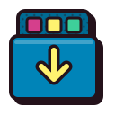
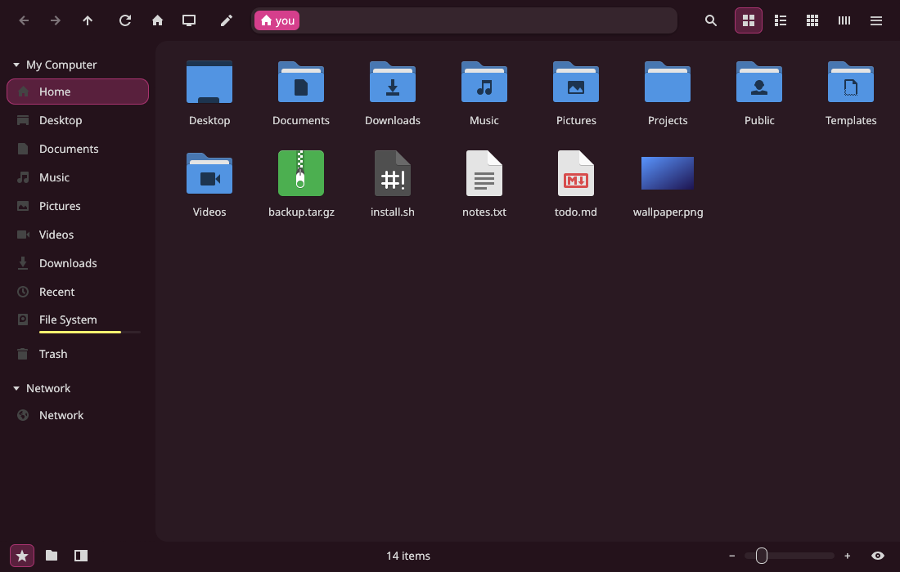
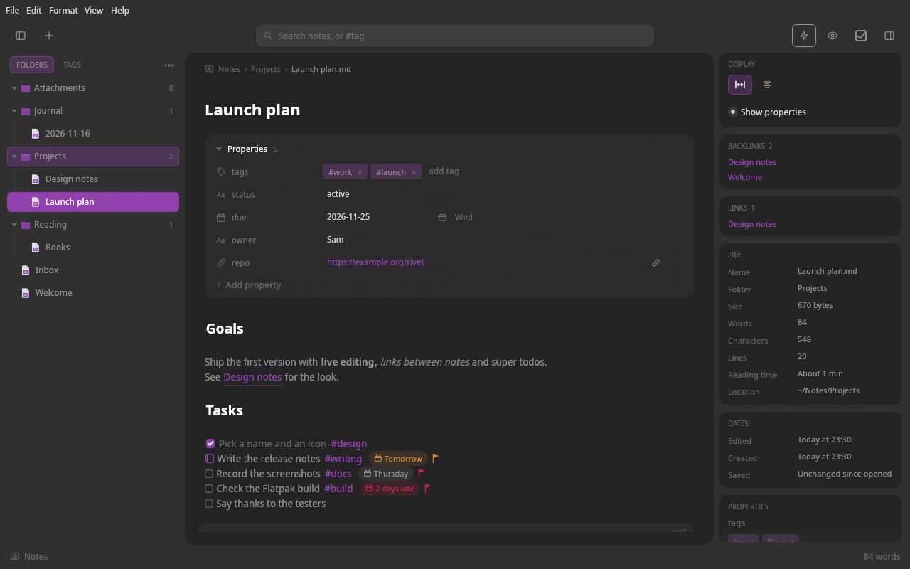
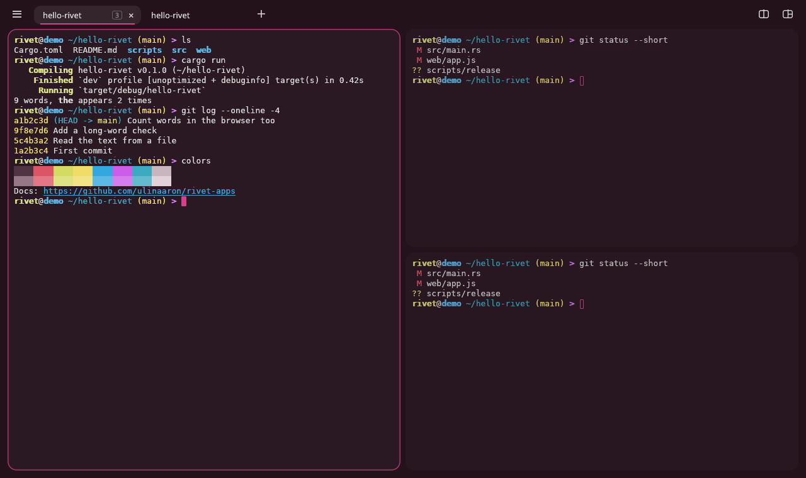

  
  &nbsp;
  
  &nbsp;
  
  &nbsp;
  
  &nbsp;
  
  &nbsp;
  
  &nbsp;
  

# Rivetsoft Apps

An ecosystem of Linux desktop software written in Rust, with no GTK or Qt: a desktop shell, a
set of apps, and a small helper that keeps them all up to date.

The website and the docs are at [rivetsoft.github.io](https://rivetsoft.github.io/).

Every piece works on its own. Rivet Files is a file manager on GNOME, KDE or any other desktop;
Rivet Shell runs alongside whatever apps you already use; nothing needs anything else installed.
Each one is released separately, with its own version and changelog. Put them together, though,
and they behave like one system.

## How they fit together

- **One look.** Every app takes your desktop's colors, fonts and icon theme, light or dark, and
  shares the same menus, toolbars, Preferences and quick panel (Ctrl+P).
- **One set of colors, from your wallpaper.** Rivet Shell runs matugen on the wallpaper you
  pick, and every Rivet app follows those colors live, with no restart.
- **One file picker.** Rivet Files can be the Open and Save window for every app, so your
  sidebar, bookmarks and views are the same everywhere.
- **Shared pieces.** Rivet Terminal uses Rivet Edit's color themes; Rivet Edit colors code the
  way Rivet Files' Peek does; Rivet FTP's saved connections also work from plain `ssh`.
- **A dock that knows them.** Rivet Shell's dock starts out with Files, Terminal, Edit and
  Notes pinned.
- **Kept current in one place.** Rivet Welcome installs and updates every app, and its tray
  icon sits in Rivet Shell's panel (or any other tray).

## Rivet Shell: the desktop

###  Rivet Shell

A desktop shell for Wayland compositors with the layer-shell protocol (niri, Hyprland, Sway and
others): a panel, a dock, an app launcher, quick settings, notifications, desktop widgets and the
wallpaper, which it gives to matugen so every app's colors follow it. Settings in the Rivet look.
**Just started:** not released yet; build it from source.
[More about Rivet Shell](apps/rivet-shell/README.md)

## The apps

###  Rivet Files

A file manager in the same vein as Dolphin, Nemo, Thunar and Caja. Minimal or packed with
panels, your choice: Peek previews, split view, filters, bulk rename, Quick Open, and it can be
your other apps' file picker.
**Stable:** released, with AppImage, archive, Flatpak and AUR packaging.
[More about Rivet Files](apps/rivet-files/README.md)

###  Rivet FTP

A dual-pane file-transfer client: this computer on one side, the server on the other, and a
transfer queue. Saved connections in groups, tabs, editing server files in place, SSH keys, and
saved connections that also work from the command line and plain `ssh`.
**Early alpha, first release 0.1.0:** SFTP works; FTP and FTPS aren't built yet.
[More about Rivet FTP](apps/rivet-ftp/README.md)

###  Rivet Notes

Markdown notes in plain folders. Live editing, properties from the frontmatter, links between
notes with backlinks, folders and tags, a slash menu, and modules for daily notes and super
todos with a list or board.
**Early alpha, first release 0.1.0:** usable, but young.
[More about Rivet Notes](apps/rivet-notes/README.md)

###  Rivet Edit

A lightweight code editor: open a folder or single files, tree-sitter colors for a dozen
languages, Go to File (Ctrl+P) and Commands (Shift+Ctrl+P) on the same quick panel as the other
apps.
**Just started:** not released yet; build it from source.
[More about Rivet Edit](apps/rivet-edit/README.md)

###  Rivet Terminal

A terminal with tabs and split panes in layouts (Tall, Fat, Grid, Side by Side, Stacked), in
your desktop's colors or any of Rivet Edit's color themes. Its keys use Ctrl+Shift, so plain
Ctrl+letters reach your programs.
**Just started:** not released yet; build it from source.
[More about Rivet Terminal](apps/rivet-terminal/README.md)

> **About the alphas.** Rivet FTP and Rivet Notes are young: things may still change or break.
> Their releases are marked as pre-releases. Use them on servers and notes you have backups of.

## Rivet Welcome: keeping it all current

###  Rivet Welcome

Optional: installs and updates the shell and the apps from their releases, and has a tray icon
that looks for new versions when you sign in and tells you when there are some. Apps installed
some other way (AUR, a distribution package) are shown but left alone.
**Just started:** not released yet; build it from source.
[More about Rivet Welcome](apps/rivet-welcome/README.md)

## Install

Each app is released on its own, with its own version and changelog, on the
[Releases page](https://github.com/rivetsoft/apps/releases). Rivet Files has an AppImage,
Flatpak and AUR packages; the other released apps come as an archive with an installer. Each
app's README has the steps.

[Rivet Welcome](apps/rivet-welcome/README.md) can install and update all of them for you. The
apps that aren't released yet are built from source: you need Rust 1.88 or newer, then
`cargo build --release -p rivet-shell` (or `rivet-edit`, `rivet-terminal`, `rivet-welcome`).

## Learn more

- [Documentation](docs/README.md): each app in depth, and the plans
- [Development](docs/development.md): building, checking, releasing, and the repository layout
- Each app's README and changelog, linked from its section above

## License

[MIT](LICENSE-MIT) or [Apache-2.0](LICENSE-APACHE), at your option.

Rivet Edit's file and folder icons are from [Material Design Icons](https://pictogrammers.com/library/mdi/)
by Pictogrammers, under the Apache License 2.0.
Rivet Terminal's terminal emulation is [alacritty_terminal](https://github.com/alacritty/alacritty) (Apache License 2.0).
The wallpaper in Rivet Shell's picture is [Sunset View](https://www.pexels.com/photo/sunset-view-1606327/)
by Vittorio Staffolani, from Pexels.
