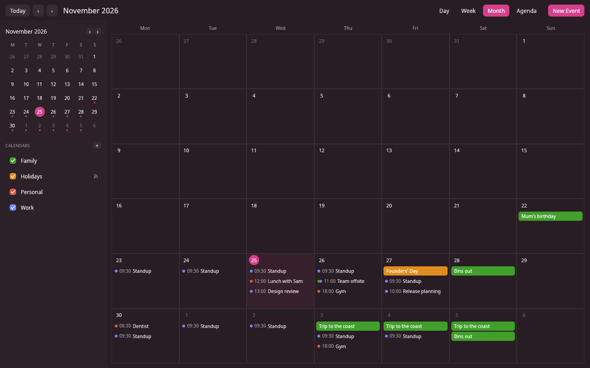

# Rivet Calendar

A calendar kept in plain `.ics` folders. See your days as a month, a week, a day or a list;
make, change and delete events, including ones that repeat; and see them on the panel's
calendar in Rivet Shell.



- **Plain files.** Each calendar is a folder in `~/.local/share/rivet-calendar` with one `.ics`
  file per event, and its name and colour in the files `displayname` and `color`. It's the
  layout vdirsyncer and khal use, so they share the same calendars: vdirsyncer can keep them in
  step with a CalDAV server (Nextcloud, Fastmail, iCloud) until Rivet does it itself.
- **Nothing lost.** An event made elsewhere keeps its alarms, attendees and anything else Rivet
  doesn't show when you change it here.
- **Repeating events.** Every day, weekday, week, month or year from the editor; a rule made in
  another program is kept as it is. Change or delete one occurrence, or all of them.
- **Subscriptions.** Subscribe to a feed (holidays, a shared calendar, any `webcal://` link)
  from + beside Calendars, or by opening the link with Rivet Calendar. It's kept as a calendar
  folder like the others, read-only, and read again every 6 hours. Opening an `.ics` file adds
  its events to a calendar you choose.
- **CalDAV accounts.** Nextcloud, Fastmail, iCloud (with an app password), Radicale and other
  CalDAV servers, from + beside Calendars. Each of the server's calendars is a folder here like
  the others, synced both ways every 5 minutes and soon after a change. When an event changed on
  both sides since the last sync, the server's version is kept. Passwords are in the keyring.
- **Google and Microsoft.** Sign in in the browser and their calendars sync the same way
  (Google over CalDAV, Outlook and Microsoft 365 over Microsoft Graph). Rivet signs in as its
  own registered app; anyone can use a client ID of their own instead
  ([docs/calendar-accounts.md](../../docs/calendar-accounts.md)).
- **On the panel.** Turn on the Calendar plugin in Rivet Shell's Settings, Plugins: days with
  events get a dot in the panel's calendar, and the chosen day's events are listed under it.
  Click one to open it here.
- **Keys.** T today, Left and Right back and on, D W M A for the views, N for a new event, Esc to
  close the editor.

```sh
cargo run -p rivet-calendar                 # the window
rivet-calendar list 14                      # the next fortnight in the terminal
rivet-calendar subscribe webcal://…/a.ics   # subscribe from the terminal
rivet-calendar refresh                      # read every subscription again now
rivet-calendar account add https://dav.example.org me   # a CalDAV account (password from input)
rivet-calendar account add google          # a Google account, signing in in the browser
rivet-calendar account add microsoft --client-id ID   # …Microsoft, as your own app
rivet-calendar sync                         # sync every server calendar now
rivet-calendar --date 2026-12-24            # the window on a day
rivet-calendar --install-desktop-entry      # into the app launcher
```

Checks: `rivet-calendar --screenshot out.png` draws sample calendars around today, never your
own. `RIVET_CALENDAR_VIEW=day|week|month|agenda` picks the view, `RIVET_CALENDAR_EDIT=1` opens
the editor on today's first event, `RIVET_CALENDAR_SUBSCRIBE=1` the subscribe dialog, `RIVET_CALENDAR_ACCOUNT=1` the add-account dialog (`=google`, `=microsoft`, `=google-own`
for the others).

Release builds are given Rivet's client IDs as `RIVET_GOOGLE_CLIENT_ID`,
`RIVET_GOOGLE_CLIENT_SECRET` and `RIVET_MICROSOFT_CLIENT_ID` when they're compiled (or from
`keys.env`, never committed); a build without them asks for your own.
