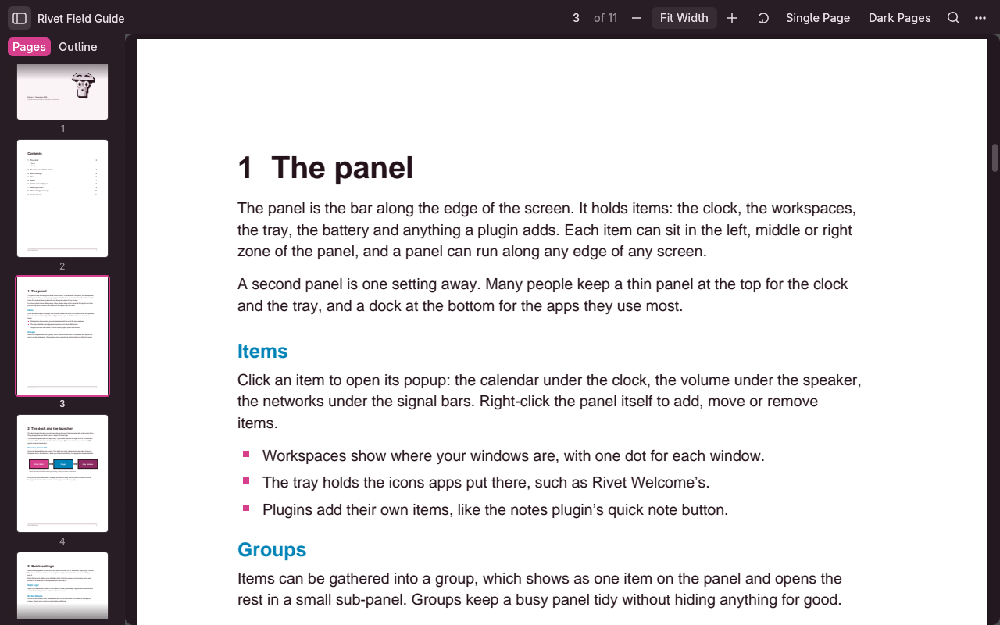

# Rivet Docs

Read PDFs and comics: one long scroll of pages or one page at a time, with thumbnails, the
outline, search, dark pages, and the page you left each file at. It is unreleased and built
from source.



```sh
cargo build -p rivet-docs
utilities/rivet-dev pdfium                 # PDFium where target/debug/rivet-docs finds it
target/debug/rivet-docs Guide.pdf
target/debug/rivet-docs --install-desktop-entry   # add it to the app launcher
```

## What it does

- **Opens** PDFs, comic books (cbz, and cbr and cb7 when the system has `unrar` or `7z`) and
  single pictures.
- **Continuous** scroll, or **Single Page**. Zoom to **Fit Width**, **Fit Page** or 10 to 800 %,
  with Ctrl and the wheel or a pinch, held still under the pointer. Rotate a quarter turn at a
  time.
- **Thumbnails** of every page, and the document's **outline**, in the sidebar. The section you
  are reading is marked.
- **Find** (Ctrl+F) lights up every match on the pages, and Enter goes to the next.
- **Select text** by dragging over it, a word with a double click or a line with three, and copy
  it with Ctrl+C.
- **Links** inside the document go to their page (Alt+Left comes back); links to websites open
  in the browser.
- **Dark pages** draw a document light on dark in the window's own colors. Colors keep their
  hue, and pictures stay as they are.
- **Remembers** the page, zoom, view and rotation of each file you open.
- **Print** a PDF through the desktop's print dialog.
- **Quick Actions** (Ctrl+Shift+P): every command, every section of the outline, and a page
  number to go to.

## Keys

| Key | Does |
| --- | --- |
| Ctrl+O | Open a document |
| Ctrl+F | Find |
| Enter, Shift+Enter | Next and previous match |
| Page Down, Page Up, Space | A screen down or up (a page, in Single Page) |
| Home, End | First and last page |
| Left, Right | Previous and next page, when the page fits the width |
| Ctrl+Plus, Ctrl+Minus | Zoom in and out |
| Ctrl+0, Ctrl+1, Ctrl+2 | Fit Width, Actual Size, Fit Page |
| Ctrl+R, Ctrl+Shift+R | Rotate right and left |
| F9 | Show or hide the sidebar |
| Alt+Left | Back, after following a link |
| Ctrl+C, Ctrl+A | Copy the selected text, select the page's text |
| Ctrl+P | Print |
| Ctrl+Shift+P | Quick Actions |
| Alt+Enter | Properties |

## Settings

`~/.config/rivet-docs/settings` keeps the view (`continuous` or `single`), dark pages
(`auto` follows the desktop, `on`, `off`) and the sidebar, and the window's menu changes
them. Where each file was left is in `~/.local/state/rivet-docs/places`, kept to the 1,000
files opened last.

## Licenses

Rivet Docs is MIT OR Apache-2.0, like the rest of the workspace. It draws PDFs with
[PDFium](https://pdfium.googlesource.com/pdfium/), the PDF engine of Chromium, which is
BSD-3-Clause. Every library it links or carries had to allow source tarballs and AppImages
under MIT OR Apache-2.0, so:

- **PDFium** is loaded when the first PDF opens, through
  [pdfium-render](https://github.com/ajrcarey/pdfium-render) (MIT OR Apache-2.0). Nothing links
  it at build time. The release archive and the AppImage carry a prebuilt `libpdfium.so` from
  [bblanchon/pdfium-binaries](https://github.com/bblanchon/pdfium-binaries) (MIT build scripts,
  Google's PDFium unchanged), pinned to one build and checked against its sha256 by
  `utilities/lib/pdfium.sh`. Rivet Docs looks for it beside the program first
  (`lib/rivet-docs/libpdfium.so`), then for the system's own.
- **Inside PDFium** are FreeType (we take its FreeType License, the FTL, rather than the GPL:
  portions of this software are copyright © The FreeType Project, www.freetype.org, all rights
  reserved), libjpeg-turbo (IJG and BSD-3-Clause), OpenJPEG (BSD-2-Clause), Little CMS (MIT),
  libpng, zlib, Abseil, Highway and LLVM's libc++ and libc (Apache-2.0), HarfBuzz (Old MIT),
  ICU (Unicode License v3), Anti-Grain Geometry 2.3, fast_float, dragonbox and simdutf (MIT,
  Apache-2.0 or Boost). Their notices are in `licenses/pdfium/` in the release archive and in
  `usr/share/licenses/rivet-docs/pdfium/` in the AppImage.
- **Comics** are read with the `zip` crate (MIT) and the pictures in them with `image` (MIT OR
  Apache-2.0). cbr and cb7 files are taken apart by the archive tools already on the system,
  which run as programs of their own and are never linked.
- **Not used:** MuPDF (AGPL) and Poppler (GPL). Neither can be bundled in an MIT OR Apache-2.0
  program, and linking Poppler from the system would make the whole program GPL.

## Not yet

EPUB books (planned next), filling in forms, adding notes or highlights to a PDF, printing comics
and pictures, and selecting text across more than one page.
