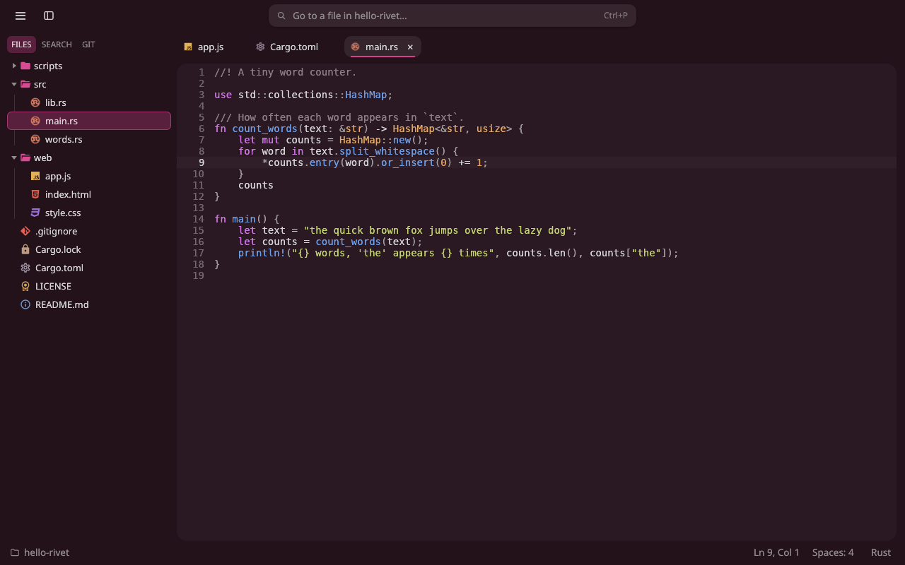
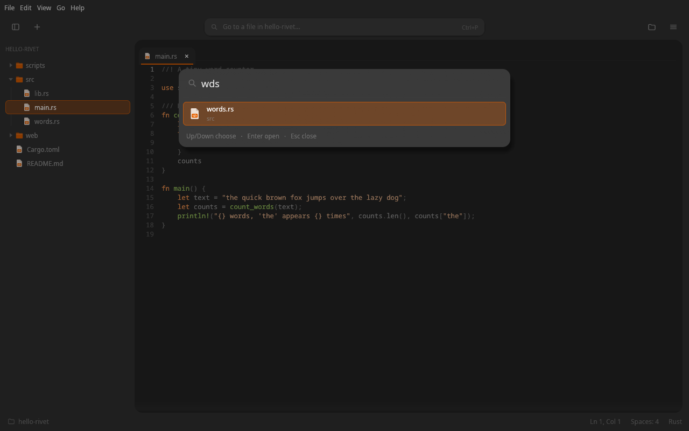
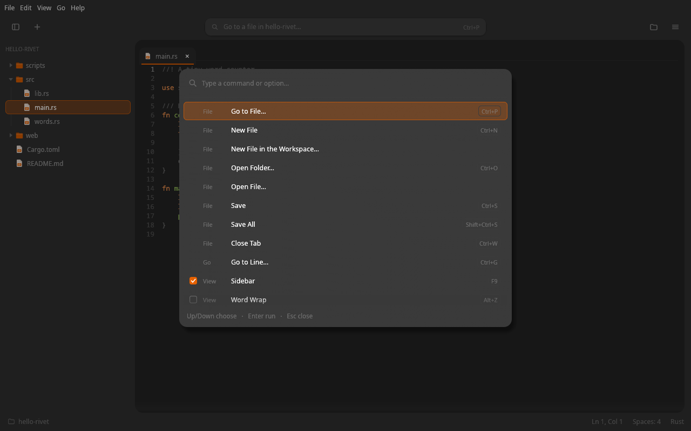
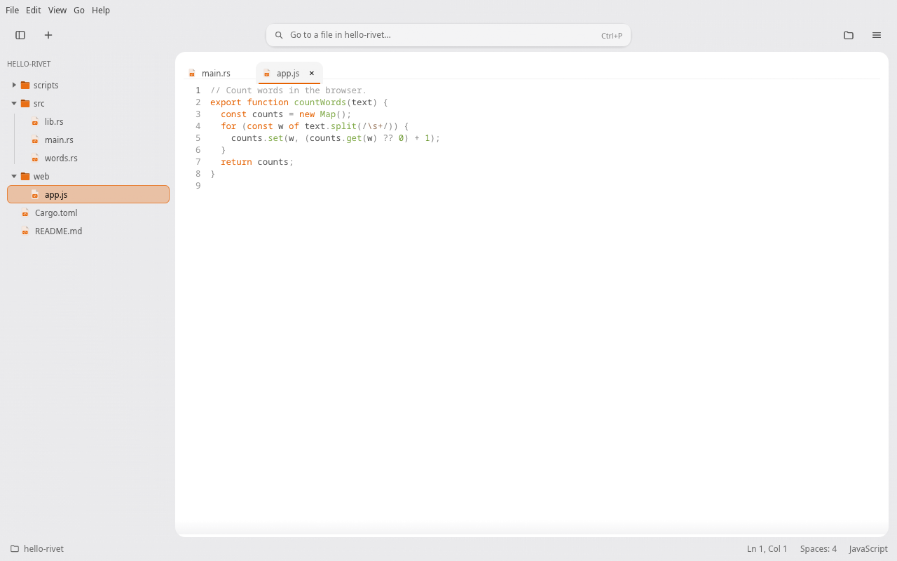
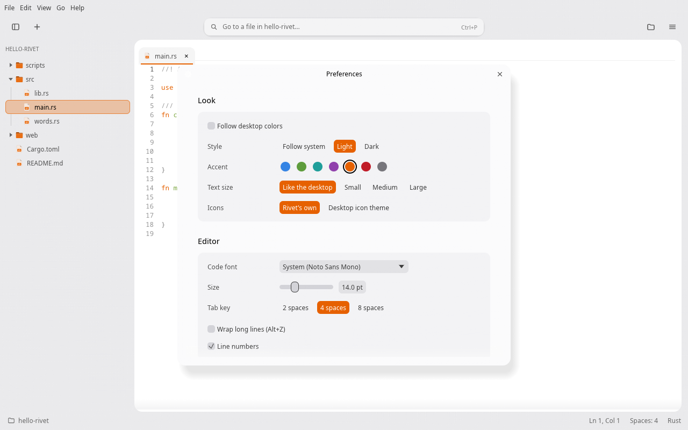

# Rivet Edit

Part of [Rivet Apps](../../README.md).

> **Just started.** Rivet Edit is brand new: the basics work, much is still to come (find and
> replace, multiple cursors, a terminal). Keep backups of what you edit with it.

A lightweight code editor built on the same parts as the other Rivet apps: your desktop's colors,
fonts and icons, the same menus, Preferences and quick panel.



## Features

- **Folders and files**: open a folder as the workspace (its files in a tree, skipping `.git`,
  `target` and `node_modules`), or single files, each in a tab.
- **Preview tabs**: a single click in the tree (or Go to File) opens a file as a preview, in
  italics, which the next preview replaces. Double-click or Ctrl+click it in the tree, double-click
  its tab, or edit it, and it stays.
- **Tree-sitter colors** for Rust, Python, JavaScript, TypeScript and TSX, JSON, shell, C, Go,
  HTML, CSS, TOML and YAML; other files get the colors Rivet Files' Peek uses. Colors follow your
  theme and accent.
- **Color themes** for the editor: One Dark and Light, Dracula, Monokai (and Pro), Solarized,
  Nord, Gruvbox, Catppuccin (Latte, Frappé, Macchiato, Mocha), Tokyo Night (and Day), GitHub
  (Light, Dark, Dimmed), Rosé Pine (Main, Moon, Dawn), Everforest, Ayu (Dark, Mirage, Light),
  Material, Palenight, Kanagawa, Night Owl, Light Owl, VS Code Dark and Light Modern, JetBrains
  Darcula, Xcode Light and Dark, and High Contrast Dark and Light. Commands → *Color Theme…*
  previews each as you move through the list; Preferences → Editor has them too. Or follow the
  app's own colors (the default).
- **Go to File** (Ctrl+P): type a few letters of a file's name or path. **Commands**
  (Shift+Ctrl+P): every command and option by name. **Go to Line** (Ctrl+G).
- Line numbers, the cursor's line and column, word wrap (Alt+Z), Tab puts in spaces, code size
  (Ctrl+= and Ctrl+-), and your choice of monospace font.
- Saves safely (write, then rename), keeps a file's permissions, reloads files changed elsewhere,
  and asks before closing or quitting with changes.

<table>
  <tr>
    <td></td>
    <td></td>
  </tr>
  <tr>
    <td></td>
    <td></td>
  </tr>
</table>

## Keys

| Key | |
| --- | --- |
| Ctrl+P | Go to a file |
| Shift+Ctrl+P | Commands |
| Ctrl+O | Open a folder (type a path; Enter goes into a folder) |
| Ctrl+N / Ctrl+S / Shift+Ctrl+S | New file / Save / Save all |
| Ctrl+W, Ctrl+Tab | Close tab, next tab |
| Ctrl+G | Go to line |
| F9 / Alt+Z / Ctrl+M | Sidebar / word wrap / menu bar |
| Ctrl+= / Ctrl+- | Bigger / smaller code |
| Ctrl+, | Preferences |
| Shift+Ctrl+N | A new window, for another workspace (File, Open Folder in New Window, or a folder's right-click menu, opens one on a folder) |
| F12 or Ctrl+click, Shift+F12 | Go to Definition, Find References (a list when there are several) |
| Alt+Left / Alt+Right | Back / forward through the places you jumped from |
| Ctrl+Space | Suggestions (they also open as you type; Enter or Tab puts one in) |
| Ctrl+F / Ctrl+H | Find / replace in the file (Enter, F3: next; Shift+Enter, Shift+F3: previous) |
| Shift+Ctrl+F | Search (and replace) in every file of the folder |
| Ctrl+D | Select the word, then add the next place it appears (another cursor) |
| Shift+Ctrl+L | A cursor at every place it appears |
| Alt+click, Ctrl+Alt+Up/Down | Another cursor there, or on the line above/below; Esc: back to one |
| Alt+Up/Down, Shift+Alt+Up/Down | Move the lines, copy the lines |
| Shift+Ctrl+K, Ctrl+L | Delete the lines, select the line |
| Ctrl+/ , Ctrl+] / Ctrl+[ | Comment the lines out (or back in), indent / outdent |
| Ctrl+Enter / Shift+Ctrl+Enter | A new line below / above |

### Vim keys

Switch them on in Preferences > Editor (or Vim Keys in the command list). Normal, Insert, Visual
and Visual Line modes; counts; `d` `c` `y` `>` `<` with motions (`w b e 0 ^ $ gg G { } % f t ; ,`)
and text objects (`iw aw i" a" i( a( i{ a{ i[ a[`); `x X s S C D Y J r ~ p P`; `u` and Ctrl+R;
`.` to repeat; `/ ? n N * #` to search; `gd`, `gr` and `K` for definition, references and hover; and `:w :q :wq :x :qa :42 :s/old/new/g :%s/old/new/g`.
The status bar shows the mode and the `:` line. Copies go to the clipboard too.

## Build and run

```sh
cargo build --release -p rivet-edit
./target/release/rivet-edit [FOLDER] [FILE...]
./target/release/rivet-edit --install-desktop-entry   # add it to the app launcher
```

Screenshots come from a demo project: `utilities/rivet-dev edit-screenshots`. Changes are in the
[changelog](CHANGELOG.md).

## Credits

File and folder icons are from [Material Design Icons](https://pictogrammers.com/library/mdi/) by
Pictogrammers, used under the Apache License 2.0 (see `LICENSE-APACHE`). Their shapes live in
`crates/rivet-look/src/mdi.rs`; the colours are Rivet's, a little closer to your accent.
