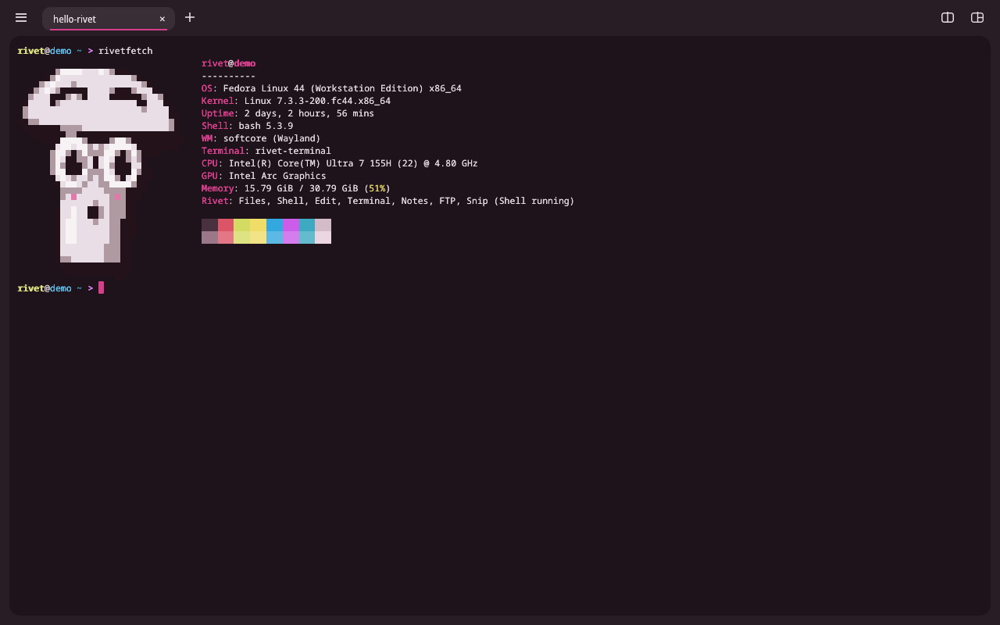

# rivetfetch

Shows this computer at a glance in the terminal, beside Rivet the mascot. **Just started**: not
released yet; build it from source.

Rivet is drawn from his pixel art (`docs/mascot/pixel/rivet-pixel.png`), two pixels to a
character cell, so he looks the same as on the website. It needs a terminal with colour; plain
output leaves him out.



- **In your colours.** The keys take the desktop's accent, from the same colour files the other
  Rivet apps follow, so a new wallpaper recolours them too.
- **Fast.** Every module runs at once; it takes about 30 ms.
- **Short by default:** OS, host, kernel, uptime, packages, shell, window manager, CPU, GPU and
  memory. Screens, theme, disk, battery, the Rivet apps installed and more are in
  `rivetfetch --list-modules`.
- **Takes fastfetch logos.** A text logo file with `$1` to `$9` for its colours works as it is.

## Using it

```sh
cargo build --release -p rivet-fetch
target/release/rivetfetch
rivetfetch --logo none                       # the facts alone
rivetfetch --modules os,kernel,memory,rivet  # what to show, in that order
rivetfetch --pipe                            # no colour, for scripts
rivetfetch --list-modules
```

`--structure os:kernel` works as well as `--modules`, as fastfetch takes it. Colour is left out
when the output isn't a terminal or `NO_COLOR` is set.

## Settings

`~/.config/rivet-fetch/settings`, one `key=value` per line:

```
logo=none             # mascot, none, or a path to a logo file
modules=title,separator,os,host,kernel,uptime,memory,rivet
color=auto            # auto, always or never
```

Command-line options win over the file.

## Where the facts come from

Nearly everything is read from the kernel's own files (`/proc`, `/sys`, `/etc/os-release`), with
no programs run. The exceptions: the shell's version (`SHELL --version`), the GTK look
(`gsettings`, then GTK's `settings.ini`), and RPM's package count (`sqlite3` on its database, or
`rpm -qa` once, kept until the database changes). The screens' current modes come from the
Wayland compositor, their names from each monitor's EDID. A module that can't find out shows
nothing.
