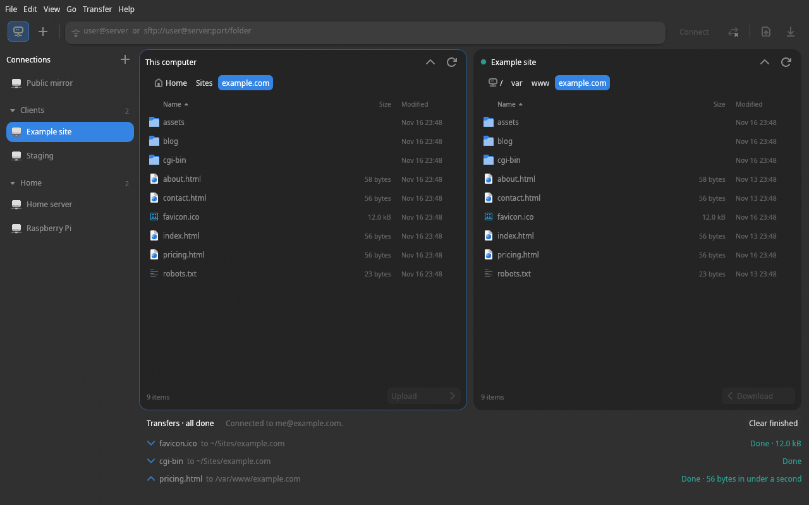
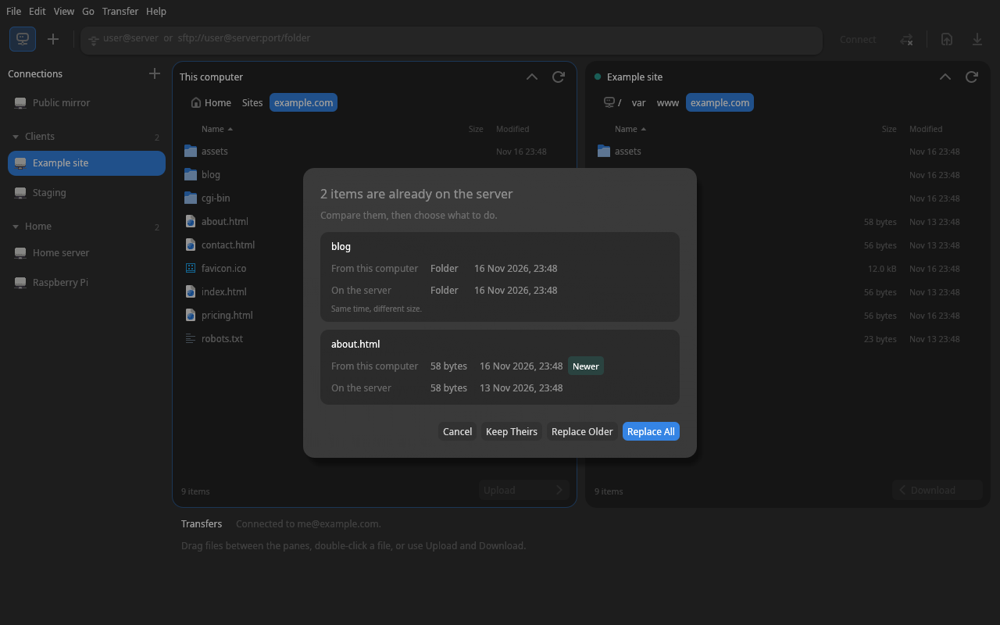
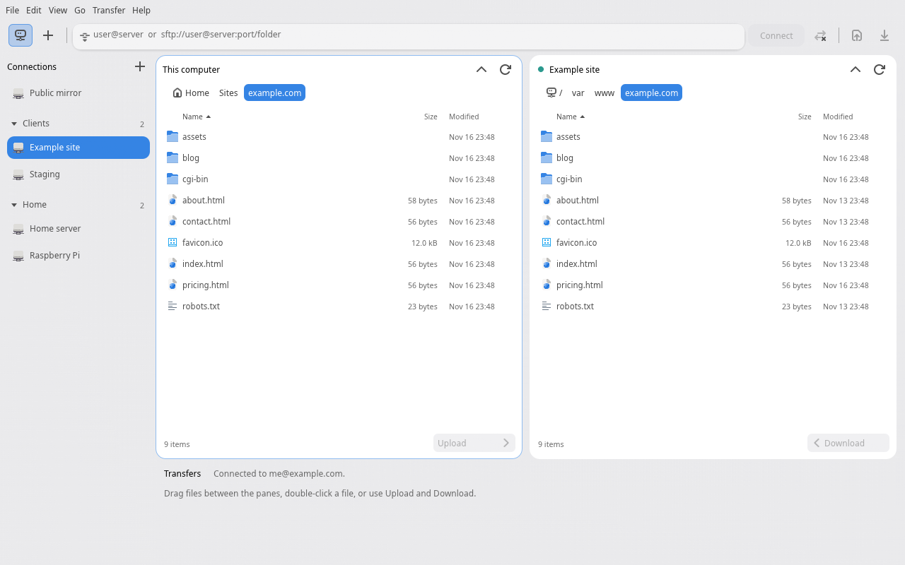
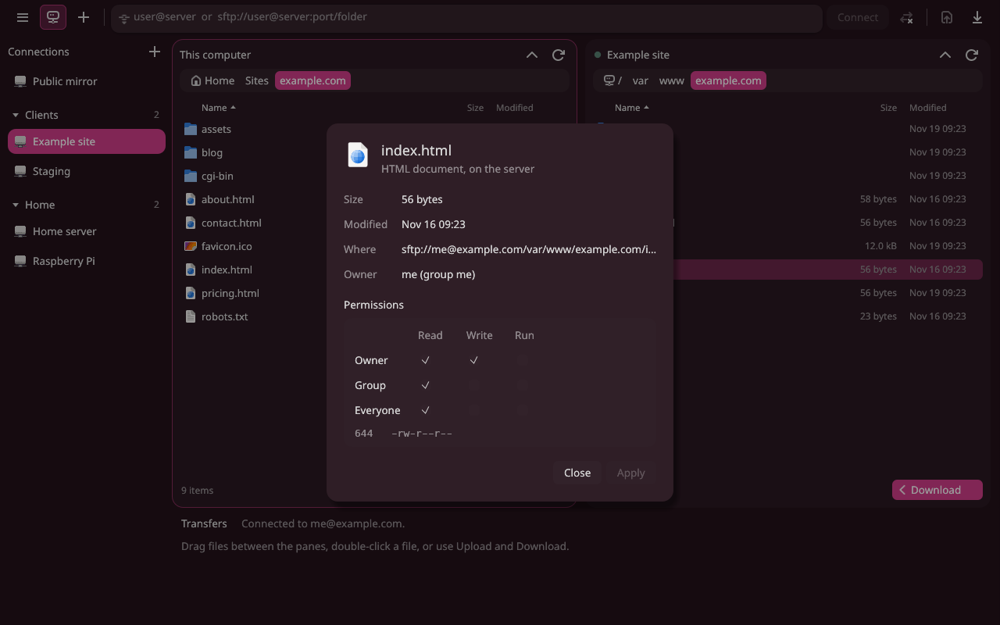
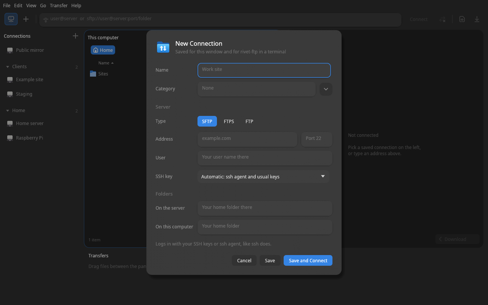
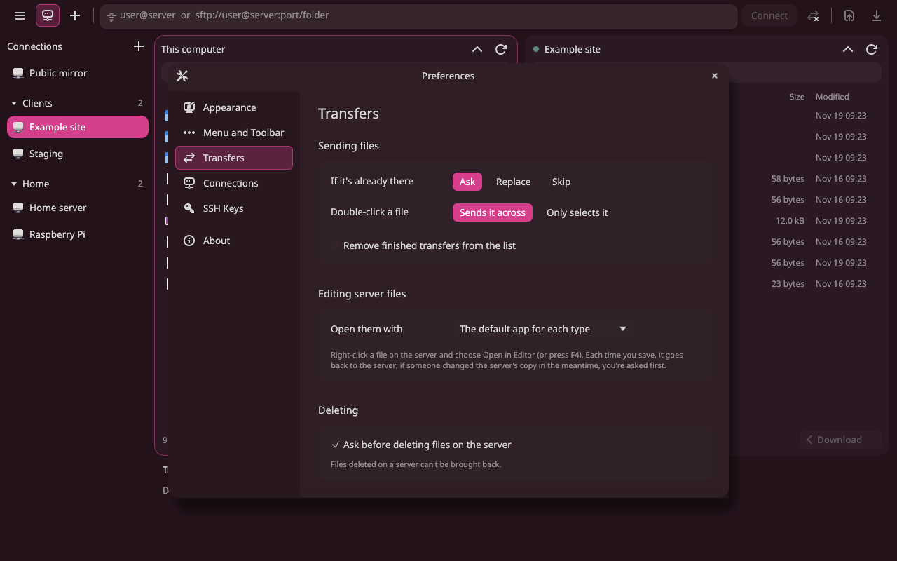
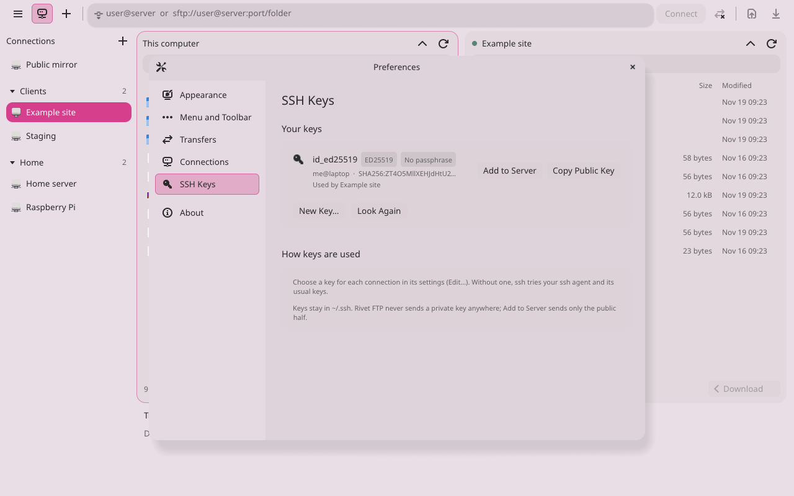

# Rivet FTP

Part of [Rivet Apps](../../README.md).

> **Early alpha.** Rivet FTP is young: things may still change or break. Try it on servers and
> files you have backups of. **SFTP works; FTP and FTPS aren't built yet.**

A dual-pane file-transfer app built on Rivet's core: this computer on one side, the server on
the other, and a transfer queue underneath. See the [plan and keys](../../docs/rivet-ftp.md).



## Features

- **Saved connections** in groups, with tabs for several servers at once; a quick-connect bar for
  `user@server`.
- **Transfers** by drag and drop, double-click, or Upload / Download, with a queue showing speed
  and progress. Files already on the other side are **compared first** (dates and sizes).
- **Edit server files** in your editor; every save goes back to the server.
- **Info and permissions** (chmod), rename, new folder, delete; previews of pictures and text.
- **SSH keys**: list, make and add keys to servers, and pick a key per connection.
- **The command line**: `rivet-ftp ssh`, `sftp`, `list` and more, and your saved connections in
  plain `ssh`, `scp`, `rsync` and `git` by name.
- Follows your desktop's colors, fonts and icon theme; light or dark; a toolbar you arrange.

<table>
  <tr>
    <td></td>
    <td></td>
  </tr>
  <tr>
    <td></td>
    <td></td>
  </tr>
  <tr>
    <td></td>
    <td></td>
  </tr>
</table>

Changes are in the [changelog](CHANGELOG.md).

## Install

Download `rivet-ftp-0.1.0-x86_64-linux.tar.gz` from the Rivet FTP release on the
[Releases page](https://github.com/rivetsoft/apps/releases) (tag `rivet-ftp-v0.1.0`), then:

```sh
tar xzf rivet-ftp-0.1.0-x86_64-linux.tar.gz
cd rivet-ftp-0.1.0-x86_64-linux
./install.sh          # rivet-ftp in ~/.local/bin, and Rivet FTP in your app launcher
```

The program is linked against glibc 2.31, so it doesn't need a recent system; the window needs
the same few libraries as Rivet Files ([the list](../rivet-files/README.md#libraries-the-window-needs)).
From a source checkout, `utilities/rivet-dev install ftp` does the same.

## Build and run

```sh
cargo build --release -p rivet-ftp
./target/release/rivet-ftp                 # the window
./target/release/rivet-ftp open work-site  # the window, connected
./target/release/rivet-ftp --help          # the command line
./target/release/rivet-ftp --install-desktop-entry   # add it to the app launcher
```

Screenshots come from a demo server made of a throwaway folder (no network, no ssh daemon):
`utilities/rivet-dev ftp-screenshots`.

SFTP goes through your system's own `sftp` program (OpenSSH), so your keys, ssh agent,
`~/.ssh/config` and known_hosts all apply. Drag files between the panes, double-click a file to
send it across, or use Upload and Download.

## Saved connections

```sh
rivet-ftp add "Work site" sftp://me@example.com:2222/var/www --key ~/.ssh/id_ed25519 --local ~/Sites/work
rivet-ftp add Pi pi@192.168.1.4          # user@server alone means SFTP
rivet-ftp add Mirror ftps://files.example.org/pub --category Clients   # a group in the sidebar
rivet-ftp list
rivet-ftp show work-site                 # by name, or its short form
rivet-ftp remove Pi
```

Addresses look like `sftp://user@server:port/folder`, `ftp://…` or `ftps://…`. Passwords are
never saved in the connections file. The window will keep them in your keyring, and SSH uses
your keys or ssh agent.

## Editing files on the server

Right-click a file on the server and choose **Open in Editor** (or press F4), or **Open With** to
pick an app. Rivet FTP downloads it to a private folder that only you can read, opens it, and
sends every save back to the server. If someone changed the server's copy since you opened it,
it asks before replacing theirs. The files open for editing are listed above the transfers;
**Stop** ends it and deletes the copy. Preferences → Transfers chooses the editor.

## SSH keys

```sh
rivet-ftp keys                           # your keys: type, passphrase, ssh agent, which connections use them
rivet-ftp add Pi pi@192.168.1.4 --key id_ed25519   # a key's short name, or a file
```

In the window, Preferences → SSH Keys lists the keys in `~/.ssh`, makes new ones (Ed25519 or
RSA 4096, with an optional passphrase), copies a public key, and adds one to a server
(`ssh-copy-id` in a terminal). Each connection's settings pick its key. Private keys never leave
`~/.ssh`. A key with a passphrase needs to be in your ssh agent (`ssh-add`) before connecting.

## Using them from a terminal

```sh
rivet-ftp ssh work-site                  # log in, starting in /var/www
rivet-ftp ssh work-site git status       # run a command there
rivet-ftp sftp work-site                 # the sftp command line, in /var/www
rivet-ftp url work-site                  # sftp://me@example.com:2222/var/www
rivet-ftp ssh work-site --print          # show the ssh command instead of running it
```

Every save also writes `~/.config/rivet-ftp/ssh_config`. Add this line near the top of
`~/.ssh/config`, and `ssh work-site`, `scp`, `rsync` and `git` will reach saved connections by name:

```
Include ~/.config/rivet-ftp/ssh_config
```

`rivet-ftp ssh-config` shows this again, with the right path.

## The file

`~/.config/rivet-ftp/connections.conf` is plain text, and only you can read it. You can edit it by hand:

```ini
[Work site]
protocol=sftp
host=example.com
port=2222
user=me
key=~/.ssh/id_ed25519
remote=/var/www
local=~/Sites/work
```
