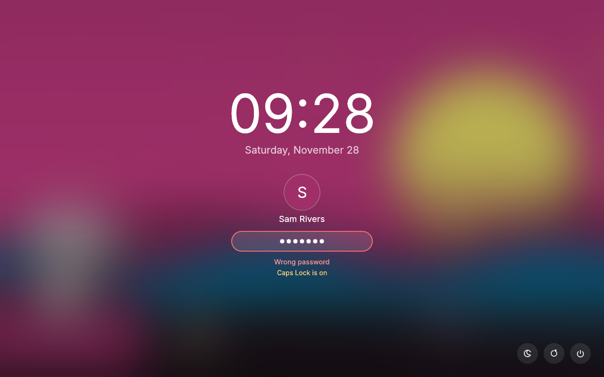

#  Rivet Greeter

A login screen for greetd that looks like Rivet Shell's lock screen, over the wallpaper and in
the colors each person chose last. **Just started**: not released yet; build it from source.


- **The lock screen's face.** The same clock, picture, password field and power buttons as
  Rivet Shell's lock screen: both draw it from the `rivet-lockscreen` crate.
- **Everyone's own wallpaper.** It shows whoever changed their wallpaper last, in their colors
  and with their clock. Tab or the arrow keys go to the next account.
- **Works without Rivet Shell.** Rivet Shell leaves your wallpaper and look for it whenever they
  change. On any other desktop, `rivet-greeter sync` does the same.
- **Signs in through greetd**, which starts the session you were using last (else the first
  Wayland session installed).



## Setting it up

You need greetd and a compositor to show the login screen in: cage, Sway or Softcore.

```sh
cargo build --release -p rivet-greeter
sudo install target/release/rivet-greeter /usr/local/bin/
sudo rivet-greeter --setup
```

`--setup` makes `/var/lib/rivet-greeter`, where each person's session leaves a copy of their
wallpaper, look, name, picture and session (greetd runs the greeter as its own user, which can't
read anyone's home folder). It then prints the lines for greetd. In `/etc/greetd/config.toml`,
with one of:

```toml
[default_session]
command = "cage -s -- rivet-greeter"
# command = "softcore --greeter rivet-greeter"
user = "greeter"
```

With Sway, put `exec "rivet-greeter; swaymsg exit"` in a file and use
`command = "sway --config FILE"`. Then change your wallpaper (or run `rivet-greeter sync`) so
yours is there, and restart greetd.

## Your wallpaper without Rivet Shell

```sh
rivet-greeter sync --wallpaper ~/Pictures/dusk.png
rivet-greeter sync --wallpaper ~/Pictures/dusk.png --clock "%-I:%M %p" --name "Sam Rivers"
```

`sync` takes your desktop's colors the way every Rivet app does (`~/.config/rivet/colors.css`,
matugen's colors, the GTK theme's), and the picture you give it. Run it again when you change
the wallpaper, or from your wallpaper program's own hook. Without `--wallpaper` it updates the
colors and keeps the picture left before.

## Coming from `rivet-shell greeter`

Rivet Shell 0.1.2 was its own greeter. `rivet-shell greeter` still works for now: it runs
`rivet-greeter` with the same words, or says how to get it when it isn't installed. The shared
folder and what's in it haven't changed, so wallpapers already left there show as before.
`sudo rivet-greeter --setup` tells you when greetd's settings still name `rivet-shell greeter`.

## Trust

The shared folder works like `/tmp`: anyone can add their own folder, nobody can change
another's. The greeter only reads a person's folder, and the files in it, when that person owns
them, so no one can put a wallpaper or a name on someone else's account. Nothing private is
left there: no settings beyond the look, and never a password.

## Checks

```sh
cargo test -p rivet-greeter -p rivet-lockscreen
target/debug/rivet-greeter --screenshot out.png
```

Screenshot hooks: `RIVET_GREETER_THEME` (light or dark), `RIVET_GREETER_ACCENT` (a color like
`#d53f8c`), `RIVET_GREETER_WALL` (a picture to show), and the lock screen's `RIVET_LOCK_TYPED=N`,
`RIVET_LOCK_ERROR=1` and `RIVET_LOCK_CONFIRM=1`. `RIVET_GREETER_DIR` reads and writes another
folder in place of `/var/lib/rivet-greeter`, to try it without root.
