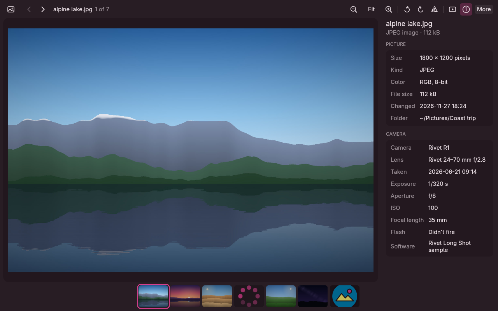

#  Rivet Long Shot

Looks through the pictures in a folder, in the Rivet apps' look. **Just started**: not released
yet; build it from source.



- **Step through a folder.** Open a picture and the arrow keys go through the rest of its
  folder, in the order Rivet Files shows it. The pictures on either side are read ahead, so the
  next one is there at once.
- **Zoom** to fit the window or to 100%, or anywhere between with the wheel or a pinch, around
  the pointer. Double-click goes between fitting and 100%; drag to move a picture bigger than
  the window.
- **Turn and flip** a picture to look at it. Rivet Long Shot asks before saving it turned (see
  below).
- **Slideshow** (F5) fills the screen and moves on every 5 seconds, or 3, 10 or 20. Space
  pauses it.
- **Details** (I): the picture's size, kind and color, and the camera, lens, exposure, date and
  place it was taken when the camera wrote them down.
- **Animations** in GIF, WebP and PNG play.
- **Copy**, **Open With**, **Set as Wallpaper** (with Rivet Shell running) and **Move to
  Trash**, with Undo.

## What it opens

| Pictures | How |
| --- | --- |
| PNG, JPEG, WebP, GIF, TIFF, BMP, ICO, TGA, QOI, PNM | Read by Rivet Long Shot itself |
| SVG | Drawn by Rivet Long Shot, sharp up close |
| Camera raw (DNG, CR2, NEF, ARW, ORF, RW2, RAF, PEF and others) | The full-size JPEG the camera keeps inside the file; the raw pixels aren't developed |
| HEIC, HEIF, AVIF, JPEG XL | With libheif's tools (`heif-dec`), `djxl`, ImageMagick or ffmpeg installed |

## Saving a turned picture

Turning and flipping change only what you see until you choose Save, and moving to another
picture asks first.

- **JPEG**: only the note inside the file that says which way is up (its EXIF orientation)
  changes. No pixel is decoded or written again, so nothing is lost.
- **PNG, WebP, TIFF, BMP, QOI, TGA, PNM**: the picture is written again in its own format with
  the same pixels. Camera details inside these files aren't kept.
- **GIF, animations, SVG, HEIC, AVIF, raw files**: turning is only for viewing.

The new file is written beside the old one and then put in its place, so a failure partway
leaves the picture as it was.

## With Rivet Files

When Rivet Long Shot is the app that opens pictures, Rivet Files tells it the order the folder is
sorted in, so the next picture is the one next to it in Files. With another app as the default,
a picture's right-click menu has **Open in Rivet Long Shot**. Files' Preview uses the same stage
for pictures, so it zooms and moves the same way.

To make Rivet Long Shot the app that opens pictures, install its launcher entry and choose it in
Rivet Files' Open With, or run:

```sh
xdg-mime default rivet-longshot.desktop image/png image/jpeg image/webp image/gif
```

## Keys

| Keys | What |
| --- | --- |
| Left / Right, Page Up / Page Down, Space | Previous / next |
| Home / End | First / last |
| + / − / 0 / 1 | Zoom in / out / fit / 100% |
| R / Shift+R | Turn right / left |
| H / V | Flip across / top to bottom |
| Ctrl+S | Save the turned picture |
| F5 | Slideshow (Space pauses, Esc ends) |
| F11 or F | Fill the screen |
| I | Details |
| Ctrl+C | Copy |
| Delete | Move to Trash |
| Ctrl+O | Open another picture |

## From a terminal

```sh
rivet-longshot PICTURE                       # and the rest of its folder
rivet-longshot FOLDER                        # its first picture
rivet-longshot --sort modified --desc PICTURE
rivet-longshot --slideshow PICTURE
```

## Settings

`~/.config/rivet-longshot/settings`, as `key=value` lines: `theme`, `accent`,
`follow_desktop_colors` and `text_size` as in the other Rivet apps, `details` (the panel is
open), `strip` (the strip of pictures along the bottom) and `slideshow_seconds`.

## How it stays quick

Pictures are read on two threads of their own and become textures when they arrive, so a frame
never waits on a file. The one shown is read first, then the two on either side. Up to 512 MB
of pictures are kept ready, least recently shown out first (`rivet-mem`'s `ByteCache`). A
picture bigger than the graphics card can show at once is shown smaller, and the panel says so.

## Licenses

Rivet Long Shot is MIT OR Apache-2.0, like the rest of the workspace, and everything built into it
can be shipped in its source archive and AppImage under those terms:

| What | For | License |
| --- | --- | --- |
| egui, eframe | The window | MIT OR Apache-2.0 |
| image (and its png, jpeg, gif, webp, tiff, bmp, ico, tga, qoi, pnm decoders) | Reading and saving pictures | MIT OR Apache-2.0 (zune-jpeg, image-webp, tiff and the rest are MIT, Apache-2.0 or Zlib) |
| resvg, usvg, tiny-skia | Drawing SVG | Apache-2.0 OR MIT |
| kamadak-exif (and its mutate_once) | Camera details | BSD-2-Clause: permissive, and asks for its copyright notice to go with binaries |
| libc | The local time | MIT OR Apache-2.0 |

Nothing under the LGPL or GPL is linked. HEIC, AVIF and JPEG XL need libraries under other
terms (libheif is LGPL, ImageMagick and ffmpeg are under their own licenses, some builds GPL),
so Rivet Long Shot doesn't link them: it runs `heif-dec`, `djxl`, `magick` or `ffmpeg` when
one is installed and reads the PNG it writes. Running a separate program isn't linking, so their
licenses don't reach Rivet Long Shot, and without them those pictures say which one to install.
Copying uses `wl-copy` or `xclip` the same way.

## Build and run

```sh
cargo build --release -p rivet-longshot
target/release/rivet-longshot --install-desktop-entry   # adds it to the app launcher
target/release/rivet-longshot ~/Pictures
```

## Screenshots

`rivet-longshot --screenshot FILE.png` draws the window in memory and saves it. With no picture
named, it paints a folder of made-up sample pictures (landscapes, a night sky, an animation and a
drawing, with made-up camera details) and opens one. These set the scene:

| Variable | What |
| --- | --- |
| `RIVET_LONGSHOT_PICK=N` | Open the Nth sample picture (from 0) |
| `RIVET_LONGSHOT_DETAILS=1` | The details panel is open |
| `RIVET_LONGSHOT_NO_STRIP=1` | No strip of pictures |
| `RIVET_LONGSHOT_ZOOM=100` or a scale | Zoomed to 100%, or to that many screen pixels per picture pixel |
| `RIVET_LONGSHOT_TURN=1` | Turned right, with the bar that offers to save it |
| `RIVET_LONGSHOT_SLIDESHOW=1` | As a slideshow draws |
| `RIVET_LONGSHOT_EMPTY=1` | With no picture open |
| `RIVET_LONGSHOT_CLICK=X,Y` | Click there once the window has settled (to open a menu) |

`utilities/rivet-dev`'s app screenshots make the README picture in a throwaway home.
