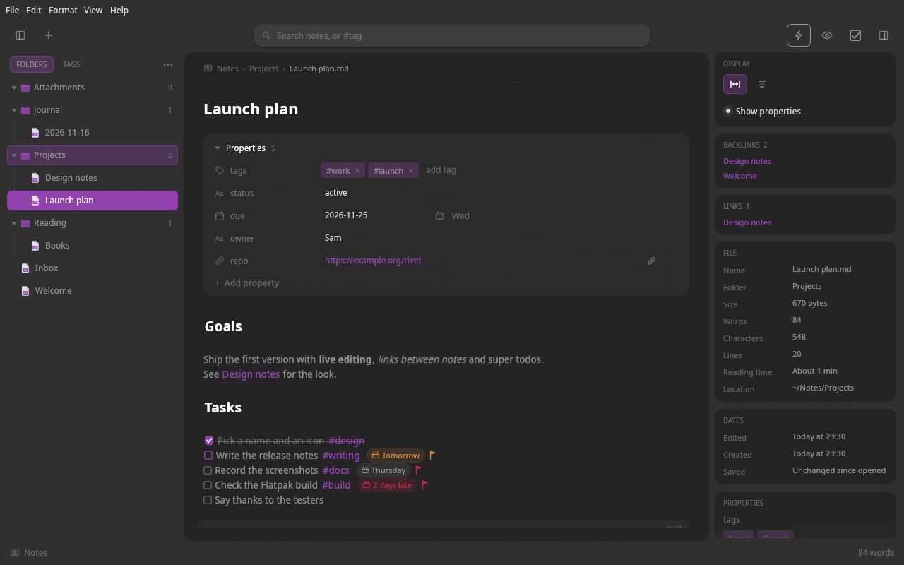
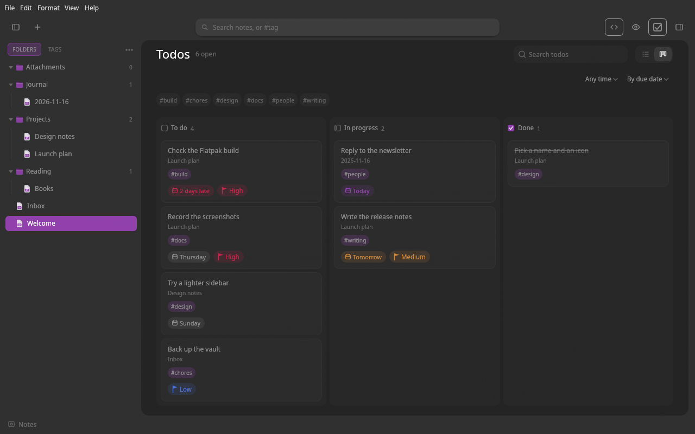
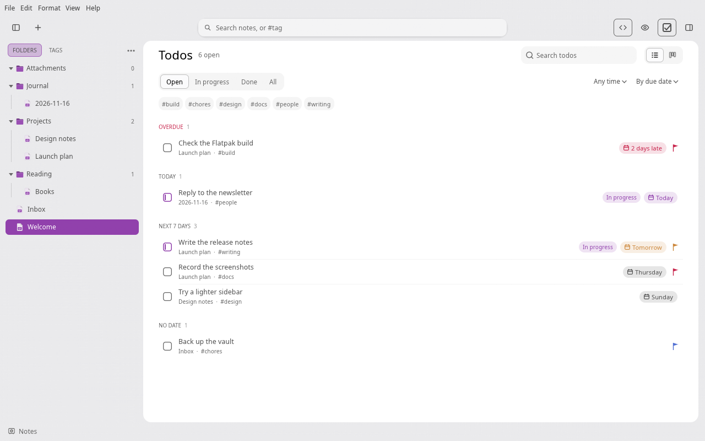
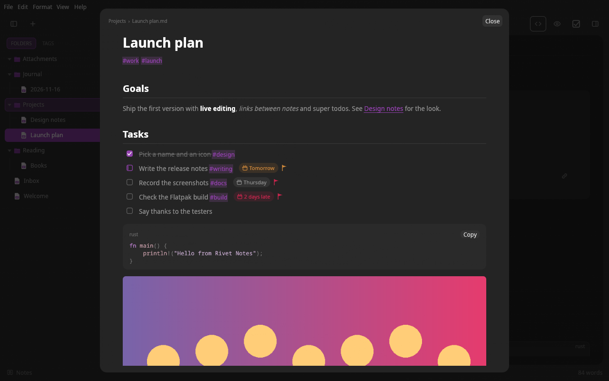
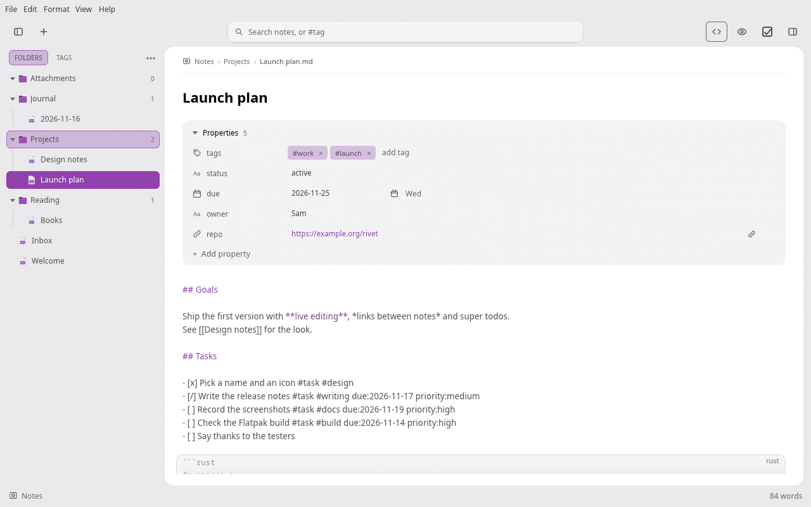
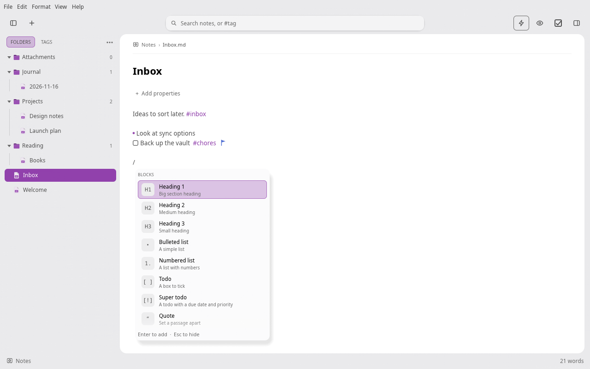
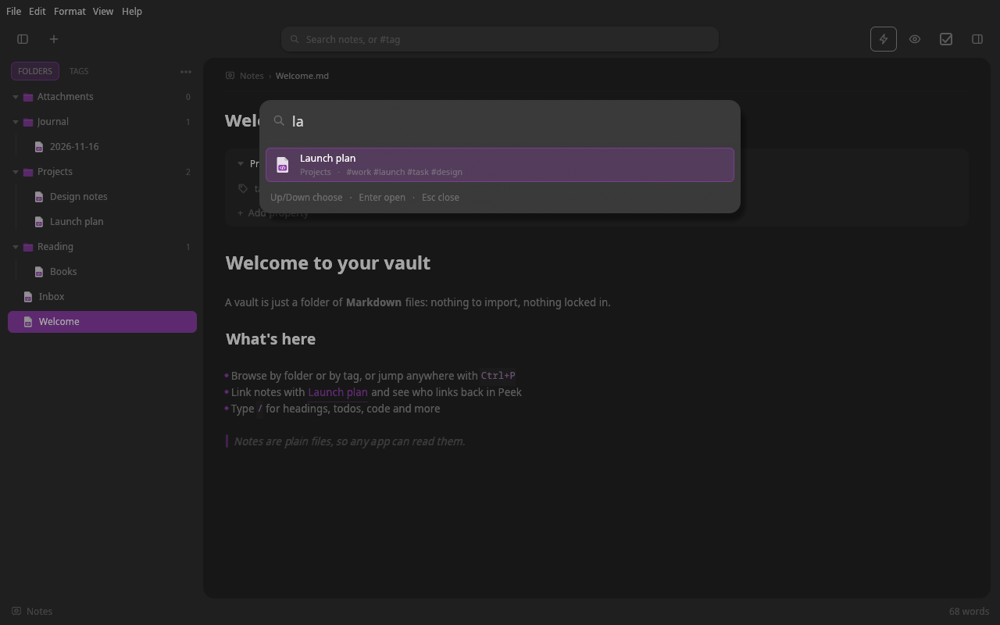

# Rivet Notes

Part of [Rivet Apps](../../README.md).

> **Early alpha.** Rivet Notes is young: things may still change or break. Try it on a copy of
> your notes, and keep backups.

Markdown notes in plain folders. A vault is any folder of `.md` files, so there's nothing to
import and nothing locked in; any other Markdown app can open the same notes.



## Features

- **Live mode**: write Markdown, see it rendered on every line but the one you're on. Or
  **Source** mode for the Markdown as written, colored. Ctrl+Space shows the whole note rendered.
- **Properties** from the frontmatter, typed (text, number, checkbox, date, list, tags, link).
- **Links between notes** with `[[Note]]`; Peek lists the backlinks. Renaming a note updates
  the links to it.
- **Folders and tags** in the sidebar, as tabs or stacked; drag notes between folders.
- **Slash menu** (`/`) for headings, lists, todos, code and more; **drag lines** by their handle.
- **Quick Open** (Ctrl+P) and **Quick Actions** (Shift+Ctrl+P).
- **Pictures and attachments**: drop files on a note; pictures show in place.
- **Modules**: **Daily notes** (Ctrl+D) and **Super todos**: tasks with a due date, priority
  and progress, rolled up on a Todos page as a list or a board.
- Follows your desktop's colors, fonts and icon theme; light or dark.

<table>
  <tr>
    <td></td>
    <td></td>
  </tr>
  <tr>
    <td></td>
    <td></td>
  </tr>
  <tr>
    <td></td>
    <td></td>
  </tr>
</table>

More in [Rivet Notes](../../docs/rivet-notes.md) (every feature and key) and the
[changelog](CHANGELOG.md).

## Build and run

```sh
cargo build --release -p rivet-notes
./target/release/rivet-notes [VAULT]               # the window
./target/release/rivet-notes tags [VAULT]          # list a vault's tags
./target/release/rivet-notes --install-desktop-entry   # add it to the app launcher
```

Screenshots come from a throwaway demo vault: `utilities/rivet-dev notes-screenshots`.
