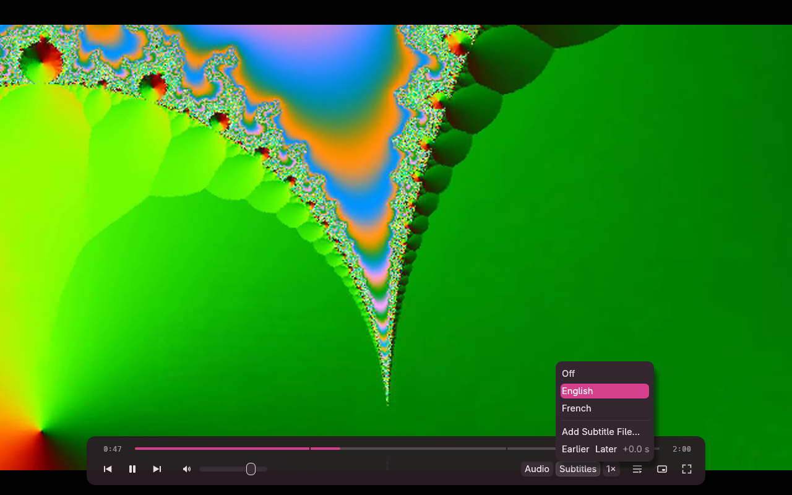
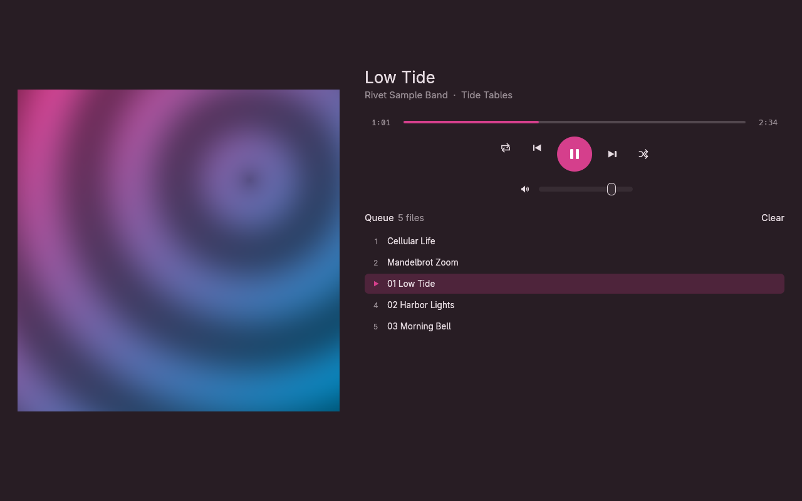

# Rivet Play

A video and music player for the Rivet desktop: play files, folders and playlists from a
queue, see a frame from anywhere on the seek bar, choose audio tracks and subtitles, and
start each file where you left it. It is unreleased and built from source.





```sh
cargo build -p rivet-play
target/debug/rivet-play ~/Videos/film.mkv
target/debug/rivet-play ~/Music/Album        # a folder plays everything in it
target/debug/rivet-play --install-desktop-entry   # add it to the app launcher
```

Rivet Play plays through **libmpv**, the library behind the mpv player, which it loads when
it starts. Install it with the system's packages:

| System | Package |
| --- | --- |
| Fedora | `mpv-libs` |
| Debian, Ubuntu | `libmpv2` |
| Arch | `mpv` |

Without it the window still opens and says what to install. The seek bar's frames come from
`ffmpeg` when it is installed.

## What it does

- **Plays** what mpv plays: nearly every video and audio format, with hardware decoding
  (VA-API) where the graphics card has it.
- **The queue** takes files, folders (everything in them, by name, then each folder inside)
  and `.m3u` or `.pls` playlists. Drag to reorder, double-click to play, repeat and shuffle.
  Opening more files while Rivet Play runs adds them to its queue.
- **The seek bar** shows a frame from where the pointer is, and marks chapters.
- **Audio and subtitle tracks** from menus. **Add Subtitle File…** loads one, and a subtitle
  file named like the video (`film.srt`, `film.en.srt`) loads by itself.
- **Resume**: a file over a minute long starts where it was left. Press Home to start over.
- **Music** gets its cover (from the file, or a `cover.jpg` beside it), title, artist and album,
  and a smaller window.
- **Fullscreen** hides the controls and the pointer after two seconds of playing.
- **Keep on Top** shows the video in a small window of its own (see below).
- **MPRIS**: media keys, Rivet Shell's player controls and `playerctl` see and control it
  (`playerctl -p rivet_play status`).
- **The screen stays awake** while a video plays, by asking the desktop (its portal). Music
  doesn't keep it awake.

## Keys

| Key | Does |
| --- | --- |
| Space, K | Play or pause |
| Left, Right | Back or forward 5 seconds (Shift: 1, Ctrl: 30) |
| J, L | Back or forward 10 seconds |
| Up, Down, scroll on the picture | Volume |
| M | Mute |
| F, double-click | Fullscreen |
| Escape | Leave fullscreen |
| [ ] Backspace | Slower, faster, normal speed |
| N, P (Page Down, Page Up) | Next, previous |
| , . | A frame back or forward |
| 0 to 9 | Jump to 0% to 90% |
| Home | Start over |
| A, S | Next audio track, next subtitles |
| Z, X | Subtitles earlier, later |
| Q | Show the queue |
| T | Keep on top |
| I | Details of the file |
| Ctrl+O, Ctrl+Shift+O | Open a file, open a folder |
| Ctrl+, | Preferences |
| Ctrl+Q | Quit |

## Keep on top

On X11 the small window asks to stay above the others. Wayland has no way for a window to ask
that, so the small window has an app id of its own, `rivet-play-pip`, for a rule in the
compositor:

| Compositor | Rule |
| --- | --- |
| Softcore | `rule.pip=app-id=rivet-play-pip floating` |
| Hyprland | `windowrulev2 = float, class:^(rivet-play-pip)$` and `windowrulev2 = pin, class:^(rivet-play-pip)$` |
| niri | `window-rule { match app-id="^rivet-play-pip$"; open-floating true; }` |
| Sway | `for_window [app_id="rivet-play-pip"] floating enable, sticky enable` |

Softcore draws floating windows over the columns of their workspace; it doesn't keep one on
every workspace yet.

## Files

- `~/.config/rivet-play/settings`: volume, resume, hardware decoding, languages, subtitle size,
  repeat and shuffle, as `key=value` lines.
- `~/.local/state/rivet-play/positions`: where each file was left (a key for the file, not its
  name), the newest 500.
- `~/.cache/rivet-play/art/`: covers taken out of music files, for the desktop's player
  controls.

## License and libmpv

Rivet Play is MIT OR Apache-2.0, like the rest of the workspace, and so is everything it is
built from. How it uses libmpv keeps it that way:

- **Nothing of mpv is in the source.** The calls into libmpv are declared in our own code
  (`crates/rivet-media/src/mpv.rs`), written from mpv's documented C API. mpv's API headers
  are under the ISC license so that programs under any license can use them, and no mpv code
  is copied.
- **Nothing is linked when building.** The program opens `libmpv.so.2` (or `.so.1`) with
  `dlopen` when it starts. Building needs no mpv headers or libraries.
- **Nothing of mpv is shipped.** The source tarball and the AppImage contain no part of mpv
  or FFmpeg; libmpv comes from the system's own packages.
- **The person who installs libmpv combines the two**, on their own computer. Distributions
  build libmpv under the GPL (version 2 or later); the GPL is about passing software on, not
  running it, and the MIT choice of Rivet's license is compatible with the GPL, so even a
  distribution that packages Rivet Play with libmpv can do so under the GPL's terms.
- **The other libraries are permissive**: egui and eframe (MIT or Apache-2.0), zbus (MIT),
  libc (MIT or Apache-2.0), raw-window-handle (MIT, Apache-2.0 or Zlib). The Rust crates that
  wrap libmpv (`libmpv2`, `libmpv-sys`) are LGPL, so they aren't used.

## Screenshots

`utilities/lib/play-samples.sh` makes sample media from ffmpeg's built-in test sources (a
fractal zoom, cellular patterns, tones) with made-up titles and covers it draws itself.
`RIVET_PLAY_SCENE` picks what a `--screenshot` shows: `video`, `seek`, `queue`, `audio`,
`prefs`, `empty` or `missing`; `RIVET_PLAY_SAMPLE` is the samples folder.

## Not yet

Streams and web addresses, a saved queue between runs, an equalizer, and chapters in a
menu of their own.
