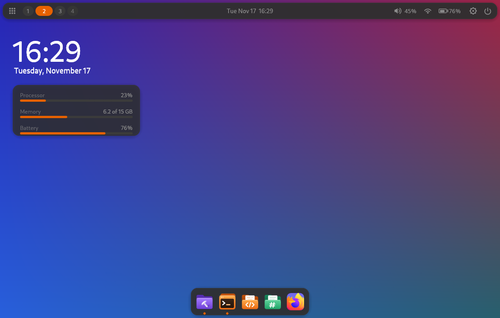

#  Rivet Shell

A desktop shell for Wayland, in the Rivet apps' look: a panel, a dock, desktop widgets and the
wallpaper, with a settings window. **Just started**: not released yet; build it from source.



- **Panel**: a launcher button, workspaces (niri, Hyprland, Sway), the clock (click for a
  calendar), volume (click to mute, scroll to change), network, battery, settings and a power
  menu (lock, suspend, log out, restart, shut down; the last three ask first). Floating or edge
  to edge, at the top or the bottom.
- **Dock**: pinned apps, a dot under the ones with windows open (niri, Hyprland), the name above
  the icon under the pointer.
- **Launcher**: every installed app, searched as you type; arrows and Enter, or click.
- **Widgets** on the desktop: a large clock and the date, processor, memory and battery.
- **Wallpaper and colors**: choose a picture in Settings; the shell shows it on every screen and
  runs [matugen](https://github.com/InioX/matugen) on it, so the desktop's colors (and every
  Rivet app's, which follow matugen live) come from the picture.
- **Settings** (`rivet-shell settings`): wallpaper, colors, panel, dock and widgets, like the
  other apps' Preferences. Changes apply to the running shell at once.

## Running it

```sh
cargo build --release -p rivet-shell
./target/release/rivet-shell                       # in your Wayland session
./target/release/rivet-shell settings              # the settings window
./target/release/rivet-shell msg launcher          # open (or close) the launcher
./target/release/rivet-shell msg quit              # stop it
./target/release/rivet-shell --install-desktop-entry   # Rivet Shell Settings in your launcher
```

Start it with your session and bind a key to the launcher:

| Compositor | Start | Launcher key |
| --- | --- | --- |
| niri | `spawn-at-startup "rivet-shell"` | `Mod+Space { spawn "rivet-shell" "msg" "launcher"; }` |
| Hyprland | `exec-once = rivet-shell` | `bind = SUPER, SPACE, exec, rivet-shell msg launcher` |
| Sway | `exec rivet-shell` | `bindsym $mod+space exec rivet-shell msg launcher` |

It needs a compositor with the wlr layer-shell protocol (niri, Hyprland, Sway, river, labwc,
Wayfire, COSMIC; not GNOME). Volume uses `wpctl` (PipeWire), Wi-Fi names `nmcli`, power
`loginctl` and `systemctl`; anything missing simply doesn't show. Stop another shell or bar
(Noctalia, Waybar…) first, or both will be on screen.

## How it's made

Each part is a layer surface drawn with egui by Rivet's own software renderer
(`rivet_kit::soft`) into shared memory: no GPU, and only when something changed (the clock each
minute, the status when it changes, hover effects). Settings live in
`~/.config/rivet-shell/settings`.
