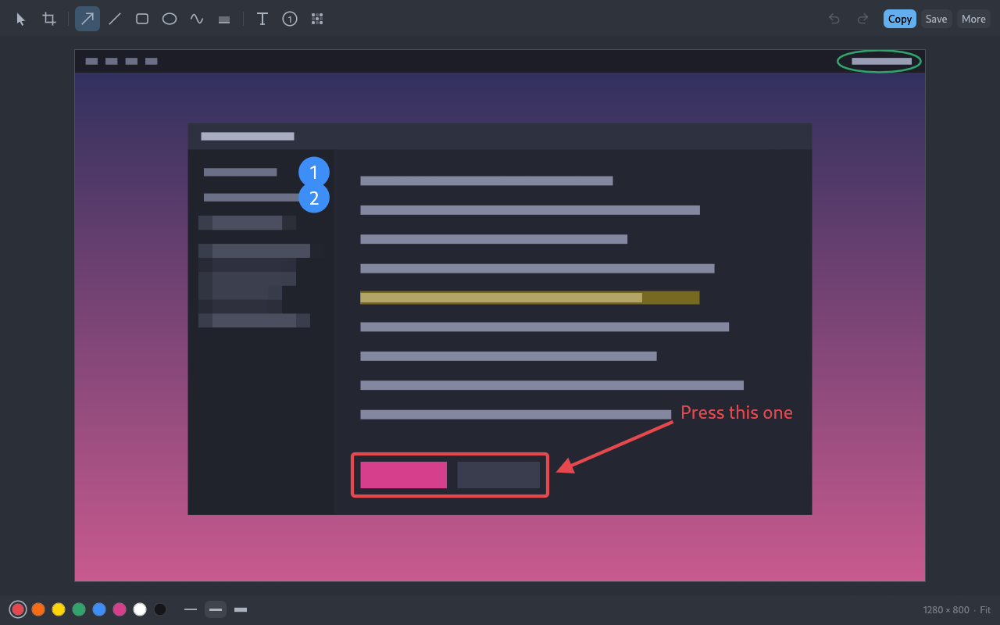

#  Rivet Snip

Clips and marks up screenshots, in the Rivet apps' look. **Just started**: not released yet;
build it from source.



- **Crop** to the part that matters. The rest of the picture is kept until you save, so Undo
  brings it back.
- **Point things out**: arrows, lines, boxes, ovals, a pen, a highlighter, text, and numbered
  circles that count up as you click.
- **Blur** what shouldn't be read. It is replaced with squares of averaged color in the saved
  picture, not covered by something that could be lifted off.
- **Move and change** a mark after drawing it: select it, drag it, pick another color or
  thickness, or remove it. Undo and Redo go through every change.
- **Copy or save.** Copy puts the finished picture on the clipboard as a PNG. Save writes a
  PNG file.

## Where the picture comes from

Rivet Snip doesn't need a particular compositor. A picture reaches it in one of these ways:

| How | What to run |
| --- | --- |
| A compositor that takes its own screenshots hands over the file | `rivet-snip FILE --replace` |
| The same, without a file | `… \| rivet-snip -` (a PNG on standard input) |
| It takes a picture of the screen itself | `rivet-snip capture` |
| From the clipboard | `rivet-snip --clipboard`, or Ctrl+V in the window |
| From a file manager | Open With on a PNG, JPEG or WebP picture, or drop one on the window |

`rivet-snip capture` uses `grim` on compositors that let programs read the screen (Sway,
Hyprland, niri, Softcore and others with wlr-screencopy), and asks the desktop for the picture
(xdg-desktop-portal) on GNOME, KDE and the rest. It opens with the Crop tool, since a picture
of the whole screen is usually wanted for one part of it. `--delay SECONDS` waits first, for a
menu that has to be open.

To bind it to a key on a compositor with no screenshot tool of its own, bind
`rivet-snip capture`.

## Where Save writes

- Opened with `--replace`: over the file it was given. This is for a compositor that has
  just saved the screenshot and wants the marked-up one in its place.
- Opened from a file without `--replace`: a new file beside it, `NAME marked.png`. The
  original is left as it was.
- With no file (a capture, the clipboard, standard input): `Screenshot from DATE TIME.png` in
  `Pictures/Screenshots`, or in the folder `save_dir` names in the settings file.

Save As and Open use the desktop's file picker (xdg-desktop-portal). Where that isn't running,
Save, dropping a picture on the window and pasting one all still work.

## Keys

| Keys | What |
| --- | --- |
| V / C | Select / Crop |
| A / L / R / O | Arrow / Line / Box / Oval |
| P / H | Pen / Highlighter |
| T / N / B | Text / Number / Blur |
| Shift while dragging | Keep a line at a multiple of 45°, or a box, oval or blur square |
| Enter / Shift+Enter | Finish the text / start a new line in it |
| Delete | Remove the selected mark |
| Ctrl+Z / Ctrl+Shift+Z | Undo / Redo |
| Ctrl+C / Ctrl+S / Ctrl+Shift+S | Copy / Save / Save As |
| Ctrl+O | Open another picture |
| Ctrl+scroll, Ctrl+0, Ctrl+1 | Zoom, fit the window, actual size |
| Scroll, or drag with the middle button | Move around a zoomed picture |

## Settings

`~/.config/rivet-snip/settings`, as `key=value` lines: `theme`, `accent`,
`follow_desktop_colors` and `text_size` as in the other Rivet apps, `save_dir` (a folder;
empty for Screenshots in your Pictures), and `close_after_copy` (also under More in the
window). The color and thickness last used are remembered there too.

## Build and run

```sh
cargo build --release -p rivet-snip
target/release/rivet-snip --install-desktop-entry   # adds it to the app launcher
target/release/rivet-snip capture
```

`wl-clipboard` is used when it is installed, so the copied picture stays on the clipboard
after the window closes; without it the picture is offered by the window itself.
