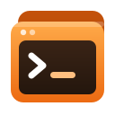
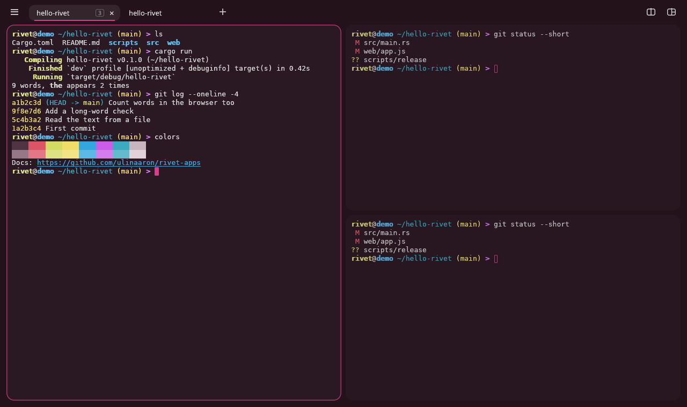

#  Rivet Terminal

A terminal with tabs and split panes, in the Rivet apps' look. **Just started**: not released
yet; build it from source.



- **Tabs and panes.** Each tab holds one or more panes, arranged by a layout: Tall (one on the
  left, the rest stacked on the right), Fat, Grid, Side by Side, Stacked, or One at a Time.
  New tabs and panes start in the folder you're in.
- **Moving between windows.** Drag a pane by the bar at its top onto another pane to swap
  them, or out of the window to move it to another window or into one of its own. A tab pulled
  down out of the strip moves the same way, and Detach Pane, Move Pane To and the tab's
  right-click menu do it from the menus. The programs keep running as they move.
- **Your colors.** It follows your desktop's colors (matugen / GTK) and accent, light or dark,
  as the other Rivet apps do, with Rivet's sixteen terminal colors leaning toward your accent.
  Or pick any of Rivet Edit's 39 color themes (One Dark, Dracula, Catppuccin, Gruvbox, Tokyo
  Night…); Color Theme in the command list shows each as you move through.
- **A real terminal.** 24-bit color, the alternate screen (vim, htop, less), mouse reporting,
  bracketed paste, wide characters, titles set by programs, and a large scrollback with search.
- **The quick panel.** Ctrl+Shift+P runs any command, like the other Rivet apps.

## Keys

Rivet Terminal's own keys use Ctrl+Shift, so plain Ctrl+letters reach your programs (Ctrl+C
stops one, Ctrl+D ends the shell).

| Keys | What |
| --- | --- |
| Ctrl+Shift+T / Ctrl+Shift+Q | New tab / close the tab |
| Ctrl+Shift+Enter / Ctrl+Shift+W | New pane / close the pane |
| Ctrl+Shift+N | New window |
| Ctrl+Shift+Right / Left, Ctrl+Tab | Next / previous tab |
| Ctrl+Shift+. / Ctrl+Shift+, | Move the tab |
| Ctrl+Shift+] / Ctrl+Shift+[ | Next / previous pane |
| Ctrl+Shift+L, Ctrl+Shift+Z | Next layout, one pane at a time |
| Ctrl+Shift+C / Ctrl+Shift+V | Copy / paste |
| Ctrl+Shift+F, Ctrl+Shift+K | Find in the scrollback, clear it |
| Shift+Page Up / Down, Ctrl+Shift+Home / End | Scroll |
| Ctrl+Shift+= / - / Backspace | Bigger / smaller / usual text |
| Ctrl+click | Open a link |
| Ctrl+Shift+P, Ctrl+, | All commands, Preferences |

## Build and run

```sh
cargo build --release -p rivet-terminal
./target/release/rivet-terminal                      # your shell
./target/release/rivet-terminal -d ~/projects        # starting there
./target/release/rivet-terminal -e htop              # a program instead of the shell
./target/release/rivet-terminal --install-desktop-entry
```

The terminal itself is `crates/rivet-term` (a session in a pseudo-terminal, and an egui widget
that draws it), so Rivet Edit can have a terminal panel with the same code.

## Credits

Terminal emulation by [alacritty_terminal](https://github.com/alacritty/alacritty) (Apache
License 2.0). Tabs, panes, layouts and the Ctrl+Shift keys follow
[kitty](https://github.com/kovidgoyal/kitty)'s lead.
