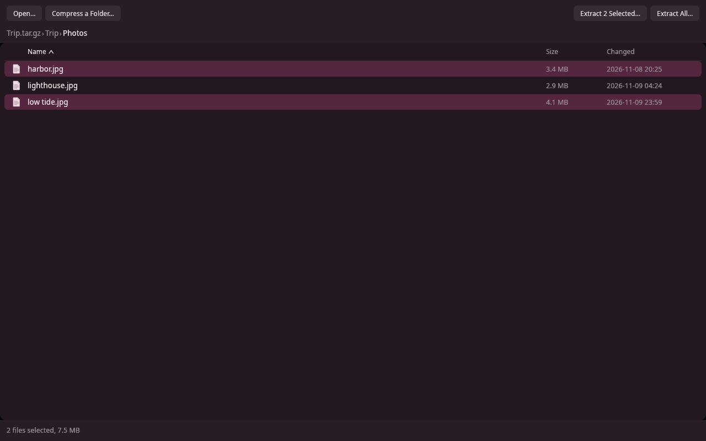

# Rivet Vice

An archive manager for the Rivet desktop: open an archive, see what is in it, take out all
or some of it, and make new ones. It is unreleased and built from source.



```sh
cargo build -p rivet-vice
target/debug/rivet-vice Photos.zip
target/debug/rivet-vice --install-desktop-entry   # add it to the app launcher
```

## What it does

- **Opens** zip, jar, tar (gz, xz, bz2, zst, lz), 7z, rar, iso, cab, deb and rpm, and single
  compressed files (gz, xz, bz2, zst).
- **Shows** the archive as folders you walk through, with each file's size and when it was
  last changed. Click a heading to sort by it.
- **Extract All** into a folder you choose. An archive with one thing at its top comes out
  as that thing; one with several gets a folder named after the archive.
- **Extract Selected** takes out only the rows you selected, keeping the folders they are in.
- **Makes** zip, tar.gz, tar.xz, tar.zst and 7z archives from a folder, or from files dropped
  on the window.
- **Never writes over** what is already there: a name that is taken gets a number after it.

It runs the archive tools the system already has (`zip`, `unzip`, `tar`, `7z`), so what it
can open depends on which of them are installed. The same code does Compress and Extract in
Rivet Files, whose right-click menu has Open in Rivet Vice for an archive.

## Keys

| Key | Does |
| --- | --- |
| Ctrl+O | Open an archive |
| Ctrl+A | Select everything in the folder shown |
| Backspace, Alt+Up | Go up a folder |
| Escape | Clear the selection |
| Ctrl+click, Shift+click | Add to the selection, or select a run |

## With no window

```sh
rivet-vice --extract-here ARCHIVE…            # beside each archive
rivet-vice --extract-to FOLDER ARCHIVE…
rivet-vice --compress --format tar.gz FILE…   # prints where the archive is
```

## Not yet

Adding to or deleting from an archive that exists, opening a file straight from an archive,
archives with a password, and splitting an archive into parts.
