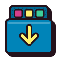
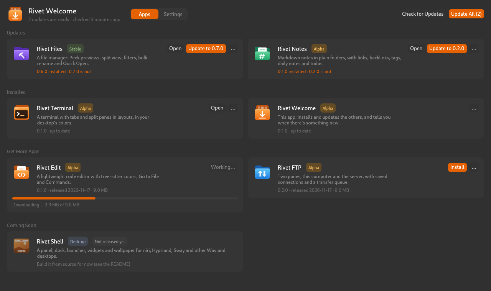
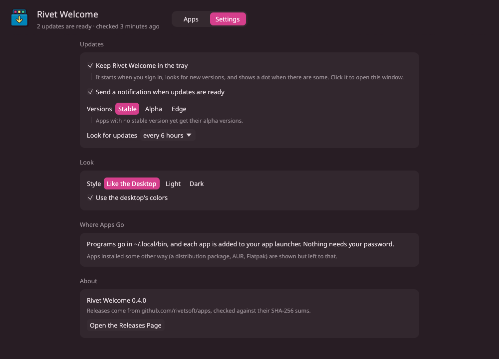

#  Rivet Welcome

Installs and updates the Rivet apps, and tells you when there's something new. It's optional:
every app can still be installed by hand from its release archive. **Alpha:** released as a
pre-release while it earns a stable release ([the bar](../../docs/stability.md)).



- **Every app in one place.** Rivet Files, Notes, Edit, Terminal, FTP, Shell and Welcome
  itself, each with what's installed, what's out, and Install, Update, Open or Remove. An app
  released after this version (a tag like `rivet-something-v0.1.0` with a Linux archive) shows
  up too, so nothing waits for Rivet Welcome to learn its name.
- **Installs the way the archives do.** It downloads the release archive for this computer,
  checks it against the `.sha256` published with it, and runs the `install.sh` inside: the
  program goes in `~/.local/bin` and the app in your launcher. No password. Removing takes the
  program and its launcher entry and icon; settings and documents stay.
- **Stable, alpha or edge.** Settings → Versions decides what's offered. Stable: an app's
  stable releases, or its alpha versions while it has no stable release yet. Alpha: every
  release, alpha versions included. Edge: a build of each app's newest code from `main`, made
  every night, shown by its commit and day (`edge build abc1234 from 2026-11-27`); an app with
  no edge build gets its newest release. Going back from Edge replaces the edge builds with
  the channel's releases, though their numbers are lower.
- **Leaves other installs alone.** An app installed by Flatpak, a package (AUR, a
  distribution) or a build in `/usr/local/bin` is shown with its version and where it came
  from, but not updated or removed here.
- **A tray icon.** It starts when you sign in and looks for releases straight away, then every
  few hours (Settings: every 3, 6 or 12 hours, daily, or only at sign-in). When there are
  updates it shows a dot and sends a notification once. Click it to open the window; its menu
  has Check for Updates and Install Updates. It works with any tray that speaks
  StatusNotifierItem: Rivet Shell, KDE, waybar and others. Turn it off in Settings.



## From a terminal

```sh
rivet-welcome                # the window (and the tray, when it's on)
rivet-welcome --tray         # only the tray
rivet-welcome list           # every app: installed and released versions
rivet-welcome check          # look for updates (exit status 2 when there are some)
rivet-welcome install notes edit
rivet-welcome update         # install every update
rivet-welcome remove ftp
```

It needs `curl`, `tar` and `sha256sum`, which nearly every Linux system has.

## When something goes wrong

Rivet Welcome changes nothing until a download is complete and checked, so a failure leaves the
version you had.

- **The download stopped.** It tries four times, carrying on from where it stopped. If it still
  fails, the half download is kept in `~/.cache/rivet-welcome/downloads` and the next try
  carries on from there.
- **"Doesn't match its checksum"** or **"has no checksum"**: the archive is refused. Try again;
  if it keeps happening, the release itself is broken, so report it.
- **Not enough space**, or **can't write to `~/.local/bin`**: it checks both before
  downloading. Free some space, or fix the folder's owner, and try again.
- **The installer failed**: the previous version is put back, and the message ends with the
  installer's last line of output.
- **GitHub's limit on checks is used up**: GitHub allows 60 checks an hour from one address.
  The message says when to try again. Set `GITHUB_TOKEN` (any token, no scopes needed) and the
  limit is 5,000.
- **"Another Rivet Welcome is installing it"**: the window, the tray and the terminal take turns
  on each app. Wait for the other one to finish.
- **An app shows "from Flatpak" or "from your system's packages"**: update it with that package
  manager. Rivet Welcome never replaces it.

## Build and run

```sh
cargo build --release -p rivet-welcome
./target/release/rivet-welcome --install-desktop-entry   # add it to the launcher
./target/release/rivet-welcome
```

Or `utilities/rivet-dev install welcome`. Rivet Welcome can then install itself from its
releases into `~/.local/bin` like the others, and the tray's sign-in entry follows it.

## Where things are

| What | Where |
| --- | --- |
| Settings | `~/.config/rivet-welcome/settings` |
| The tray's sign-in entry | `~/.config/autostart/rivet-welcome-tray.desktop` |
| The last releases list | `~/.cache/rivet-welcome/releases.json` |
| Downloads in progress | `~/.cache/rivet-welcome/downloads` |
| Programs it installs | `~/.local/bin` (or `$XDG_BIN_HOME`) |

For testing: `RIVET_WELCOME_REPO=owner/name` looks at another repository's releases,
`RIVET_WELCOME_RELEASES=FILE` reads the list from a file (GitHub's JSON) instead, and
`RIVET_WELCOME_API=URL` talks to a stand-in for GitHub's API. `utilities/rivet-dev welcome-e2e`
runs the whole cycle against one: the last release updates itself to this build, which then
installs, updates and removes apps.
