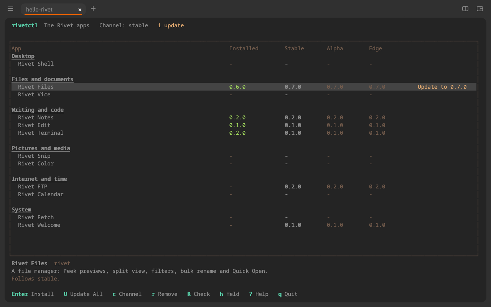

# rivetctl

Installs, updates, removes and builds the Rivet apps from the terminal. **Just started**: held
back from release; build it from source.

Run it on its own for a full-screen list of every app by category, with what's installed and
what each channel offers. Give it a command and it does that one thing, for scripts. And
`rivetctl mcp` lets an AI assistant do the same, asking first before anything changes.



It runs on the same engine as Rivet Welcome (`crates/rivet-install`): the same releases, the
same channels, the same installs in `~/.local/bin` and the same lock, so the two never disagree
and never install one app at the same time.

## Using it

```sh
cargo build --release -p rivetctl
target/release/rivetctl                      # the full-screen list
rivetctl list                                # every app, installed and offered
rivetctl install notes edit                  # install, or update
rivetctl install notes --channel edge        # from the edge channel, from now on
rivetctl update                              # every update (also: update --all, update notes)
rivetctl remove notes                        # its settings and notes stay
rivetctl channel                             # the channel every app follows, and the apps with their own
rivetctl channel notes alpha                 # stable, alpha, edge, or default to follow Rivet Welcome
rivetctl build fetch@main                    # from source at a branch, tag or commit
rivetctl doctor                              # what's missing here, and what to install
```

`--json` prints JSON instead, for `list`, `install`, `update`, `remove`, `channel` and
`doctor`. `--held` includes the apps held back from release; without it they're never shown.

In the list: Up and Down pick an app, Enter installs it or its update, U installs every update,
c chooses its channel, r removes it, R looks for new releases, h shows the held apps, ? lists the
keys and q quits.

## Channels

- **Stable**: full releases, and the alpha of an app with no full release yet.
- **Alpha**: every release, alphas included.
- **Edge**: a build of each app's newest code, made every night. It can break.

Every app follows the channel chosen in Rivet Welcome's settings (stable when there's none). One
app can have its own: `rivetctl channel notes edge`. Rivet Welcome reads that too, so it
doesn't move Rivet Notes back to stable.

## Building from source

`rivetctl build APP[@REF]` keeps a copy of the source in `~/.cache/rivetctl/source`, checks out
the branch, tag or commit (`main` when there's none), and runs that commit's own installer, the
one `utilities/rivet-dev install` runs. Rivet Reader's PDFium comes with it. It needs git and
Rust's cargo.

## For AI assistants

`rivetctl mcp` speaks the Model Context Protocol over standard input and output. Add it to an
assistant as a local server whose command is `rivetctl mcp`. Its tools are `list_apps`,
`app_status`, `install_app`, `update_apps`, `remove_app` and `doctor`. Installing, updating
and removing change nothing until they're called with `confirm` set to true; without it they
say what they would do. `docs/app-actions.md` is the plan for the apps' own actions.
